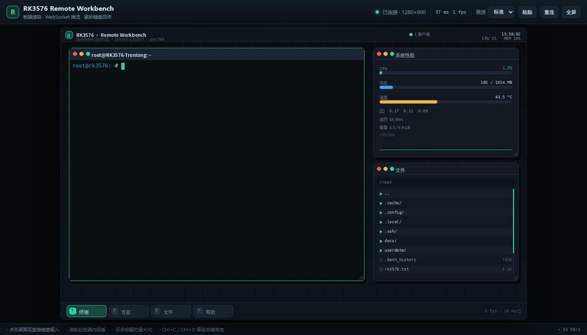

# RK3576 开发板远程工作台

面向无显示器 / 无键鼠的 **TL3576-EVM（RK3576）** 开发板，提供两条远程访问路线：

| 方案 | 状态 | 入口 | 说明 |
| --- | --- | --- | --- |
| **RKDesk** | ✅ 当前主力 | <http://192.168.31.153:8088> | 板端渲染虚拟桌面，浏览器显示 + 鼠标键盘回传，含 PTY 终端 |
| Visualisation | 🗄️ 旧 MVP | `Visualisation/` | Node/Express + noVNC 外壳；依赖的 `board_agent.py` 读 `/dev/fb0` 为全黑 |



## 快速开始

```bash
# 浏览器直接打开
http://192.168.31.153:8088

# 重新部署（改代码后）
cd RKDesk && bash deploy.sh
```

板端管理：

```bash
ssh rk3576
/etc/init.d/S99rkdesk status
/etc/init.d/S99rkdesk restart
tail -f /var/log/rkdesk.log
```

## 文档

- [RKDesk 设计、接口、性能与限制](RKDesk/README.md)
- [mlsysbook IDE Setup 实验（RK3576 版）](RKDesk/docs/mlsys-ide-setup.md)
- [板端环境校验报告](RKDesk/docs/env-report.txt)
- [并发开发协作说明](COORDINATION.md)

## 环境快照

```text
Board      : TL3576-EVM / RK3576-Tronlong
OS         : Buildroot 2024.02
Kernel     : Linux 6.1.115-rt16 (aarch64)
Memory     : 1.9 GiB visible + 2 GiB swapfile
Storage    : 29.1 GB eMMC (rootfs 9.9 GB, 4.6 GB free)
Python     : 3.11.8, numpy 1.26.4, OpenCV 5.0.0, Pillow 13.0.0,
             onnxruntime 1.31.0, torch 2.2.0, rknnlite/rknn
Network    : eth0 192.168.31.153/24
SSH        : OpenSSH 9.6p1, root key login
```

## 已知问题

- `/usr/bin/weston` 已被写坏（56 字节错误文本），原 Weston 桌面无法启动；
  恢复方法见 [RKDesk/README.md](RKDesk/README.md#恢复-weston可选)。
- 旧 `board_agent.py` 仍在 8765 端口运行且画面全黑，可安全停止。
- 默认无认证，仅限局域网；跨网请用 SSH 隧道。
