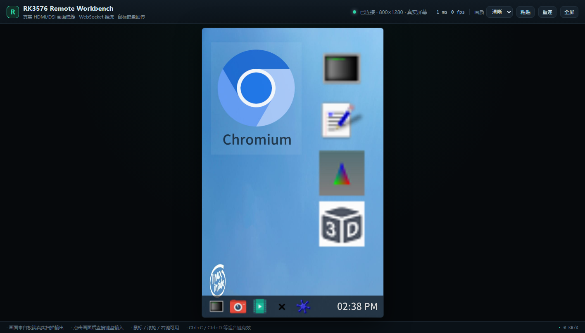

# RKDesk · RK3576 真实屏幕远程工作台

把 RK3576 开发板的 **HDMI / DSI 实际输出画面**镜像到浏览器，并用本机鼠标键盘直接操作板端桌面。
画面不是自绘 UI，而是从 DRM/KMS 当前扫描缓冲区读出的真实像素；输入通过 `/dev/uinput`
注入 Weston，和接物理显示器/鼠标的体验一致。



当前实测环境：TL3576-MiniEVM，Buildroot 2024.02，Weston 14.0.1。
DSI-1 原生 800×1280，Weston 以 `rotate-90` 合成出 **1280×800 横向桌面**；
HDMI 未接，接上后会自动切到 1920×1080 并自适应。

## 为什么不是 VNC

板端是精简 Buildroot：

- 没有 `vncserver` / `x11vnc` / `wayvnc`，也没有包管理器；
- Weston 只编译了 DRM 后端，没有 VNC / headless 后端；
- `weston-screenshooter` 对普通客户端返回 `Output capture error: unauthorized`；
- `/dev/fb0` 是 Rockchip 的 fbdev 模拟，Weston 用 GBM 渲染，读出来全黑。

所以 RKDesk 直接走 **DRM dma-buf**：取当前 CRTC 的 framebuffer，`drmPrimeHandleToFD`
导出 dma-buf，`mmap` 后按 `BGRX` 解成 RGB，编码 JPEG 推给浏览器。这是屏幕上真正
正在扫描输出的内容，HDMI 和 DSI 都适用。

## 快速开始

浏览器打开：

```text
http://192.168.31.153:8088
```

点击画面后即可用本机鼠标/键盘操作板端。界面包括：

- 顶部：连接状态、延迟、帧率、板端信息面板；
- 底部悬浮工具栏：适应 / 1:1、画质、截图、粘贴、全屏；
- 右侧信息面板：分辨率、主机、CPU/内存/温度、磁盘、带宽。

部署（改完代码）：

```bash
cd F:/data/RK3576/RKDesk
bash deploy.sh
```

板端服务：

```bash
ssh rk3576
/etc/init.d/S48rkdesk-input status   # 虚拟鼠标/键盘（必须早于 Weston）
/etc/init.d/S49weston status         # 真实桌面合成器
/etc/init.d/S99rkdesk status         # 抓屏 + WebSocket 服务
tail -f /var/log/rkdesk.log
```

> 输入设备独立在 `rkdesk_input.py` 守护进程里，重启 `S99rkdesk` **不会**重启 Weston，
> 不会关掉你正在用的窗口。只有重启 `S48rkdesk-input` 才会重建设备并重启 Weston。

## 架构

```text
┌──────────────────────────── 浏览器 ────────────────────────────┐
│  canvas ← JPEG 帧 (WebSocket binary)                           │
│  鼠标/键盘/滚轮 ── JSON (WebSocket text) ──┐                    │
└────────────────────────────────────────────┼───────────────────┘
                                             ▼
┌──────────────────────── RK3576 板端 ───────────────────────────┐
│  rkdesk_server.py                                              │
│    ├─ 抓帧线程：DRM CRTC fb → dma-buf mmap → JPEG（15 ms/帧）   │
│    ├─ WebSocket / HTTP / 静态页面                              │
│    └─ 输入转发 → /var/run/rkdesk-input.sock                    │
│                                                                │
│  rkdesk_input.py（S48 启动，早于 Weston）                       │
│    ├─ RKDesk AbsMouse：ABS_X/Y + 按键 + 滚轮（libinput: pointer）│
│    └─ RKDesk Keyboard：全键码                                  │
│                            │                                   │
│                            ▼                                   │
│  Weston 14.0.1（DRM/GBM，DSI-1 1280×800 rotate-90 或 HDMI 1920×1080）│
└────────────────────────────────────────────────────────────────┘
```

## 功能

- **真实画面镜像**：1280×800 / 1920×1080 自动适配，不缩放板端 UI。
- **绝对鼠标**：浏览器坐标 1:1 映射到逻辑桌面，支持左/中/右键、拖动、滚轮。
- **键盘**：ASCII 字符、方向键、F1–F12、Ctrl/Alt/Shift/Meta 组合键。
- **断线重连**：客户端自动重连，服务端帧缓存保证新客户端立即出画。
- **静态省流**：画面不变时不编码、不发送（0 KB/s），变化时 15 fps。
- **多客户端**：共享同一块板端屏幕（和 VNC 一样）。
- **界面工具**：适应/1:1 缩放、画质切换、PNG 截图、板端状态侧栏。
- **虚拟桌面兜底**：`--mode virtual` 可在没有 Weston/DRM 时使用板端自绘桌面。

## 性能（实测）

| 指标 | 数值 |
| --- | --- |
| DRM 抓帧 | 14.7 ms/帧（原生 800×1280） |
| JPEG 编码 q78 | 约 16 ms/帧 |
| 推流 | 15.1 fps，拖动时约 980 KB/s，静止 0 |
| 平均帧大小 | 64.6 KB |
| 服务内存 | 约 52 MB |
| CPU | 推流时约 50% 单核（RK3576 共 8 核） |

## 输入说明

- 鼠标位置是**绝对坐标**，不会像相对鼠标那样漂移；板端会画出自己的光标（已包含在抓屏里），
  浏览器端隐藏本地光标，避免双指针。
- DSI 旋转输出下，服务端会把逻辑桌面坐标反变换成设备原始轴（90° 旋转需要交换 X/Y 并翻转一轴），
  所以点击落点和光标位置一致。
- 输入通道是长连接；守护进程重启后服务端会自动重连并重发 1280×800 几何信息，
  避免设备回落到默认 800×1280 造成坐标比例错位 / 跳区域。
- 键盘直接注入 Weston 当前焦点窗口。中文输入依赖板端输入法；当前镜像没有中文 IME，
  所以浏览器里输入中文不会进入板端应用（ASCII 正常）。
- 粘贴按钮发送的是按键序列，同样只支持 ASCII。

## HDMI / DSI

`/etc/profile.d/weston.sh` 把 `WESTON_DRM_PRIMARY` 设为 `HDMI-A-1`。`/usr/bin/weston`
启动器会检查连接状态：

- HDMI 已连接 → 使用 HDMI（通常 1920×1080 横向）；
- HDMI 未连接、DSI 已连接 → 使用 DSI-1，并由
  `deploy/99-rkdesk-rotate.ini` 的 `transform=rotate-90` 合成 **1280×800 横向桌面**。

抓屏端每 2 秒重选最大的活动 CRTC，并读取 `wayland-info` 的 transform / logical size：

- DSI 原始缓冲 800×1280，顺时针旋转 90° 后推流为 1280×800，鼠标坐标做逆变换；
- HDMI 原始缓冲已经是横向，不旋转，按 1920×1080 直接推流。

删除 `/etc/xdg/weston/weston.ini.d/99-rkdesk-rotate.ini` 并重启 Weston，即可恢复原生竖屏
800×1280 布局。

## HTTP / WebSocket

| 路径 | 说明 |
| --- | --- |
| `GET /` | Web 客户端 |
| `GET /healthz` | 模式、分辨率、客户端数、fps、编码耗时 |
| `GET /api/stats` | 板端 CPU/内存/温度/磁盘 |
| `GET /api/screenshot.jpg` | 当前真实屏幕单帧（脚本/文档用） |
| `GET /api/debug` | 内部状态（模式、窗口/输入） |
| `WS /ws` | JPEG 帧 + 输入事件 |

输入消息：

```json
{"t":"move","x":300,"y":200}
{"t":"down","x":300,"y":200,"b":0}
{"t":"up","x":300,"y":200,"b":0}
{"t":"wheel","x":300,"y":200,"dy":-1}
{"t":"key","key":"Enter","ctrl":false,"alt":false,"shift":false}
{"t":"text","text":"uname -a\n"}
{"t":"quality","value":78}
{"t":"ping","ts":123.4}
```

`b`: 0 左键、1 中键、2 右键。

## 目录

```text
RKDesk/
├─ board/
│  ├─ rkdesk_server.py       # Web 服务入口
│  ├─ rkdesk_input.py        # 输入守护进程（S48）
│  └─ rkdesk/
│     ├─ server.py           # HTTP / WebSocket / 帧循环
│     ├─ mirror.py           # DRM 抓屏 + 输入转发客户端
│     ├─ drm.py              # KMS/dma-buf 抓帧
│     ├─ input.py            # uinput 绝对鼠标 / 键盘
│     ├─ desktop.py          # 虚拟桌面兜底（--mode virtual）
│     └─ terminal.py         # 虚拟模式 PTY 终端
├─ web/                      # 浏览器客户端（无构建步骤）
├─ deploy.sh                 # tar over SSH 部署
├─ deploy/
│  ├─ S48rkdesk-input        # 输入设备，早于 Weston
│  ├─ S49weston              # 修复后的 Weston init（停止逻辑）
│  ├─ S99rkdesk              # 抓屏服务
│  ├─ 99-rkdesk-rotate.ini   # DSI rotate-90 → 1280×800 横向
│  └─ weston                 # wet_main 启动器，安装到 /usr/bin/weston
├─ tools/
│  ├─ verify_env.py          # mlsys IDE 实验环境校验
│  ├─ ws_bench.js            # 帧率/带宽压测
│  ├─ cdp_shot.js            # 无头浏览器截图
│  ├─ drm_capture.py         # 独立抓帧脚本
│  └─ package.json           # 诊断脚本的 ws 依赖
└─ docs/
   ├─ browser-mirror.png     # 浏览器中的真实桌面
   ├─ browser-panel.png      # 板端状态侧栏
   ├─ browser-live.png       # 浏览器事件链路输入验证
   ├─ screen.jpg             # 真实桌面原图（1280×800）
   ├─ screen-terminal.jpg    # 板端 Wayland Terminal 执行命令
   ├─ env-report.txt
   └─ mlsys-ide-setup.md
```

## 已知限制

- 没有音频转发；板端声卡节点存在，但未接扬声器。
- 默认无认证、无 TLS，仅限可信局域网；跨网请用 SSH 隧道或 `--token`。
- 浏览器到板端的键盘是按键级注入，中文/emoji 需要板端 IME。
- 服务重启不会重启 Weston；但重启输入守护进程会重建设备，Weston 需要重启才能看到新设备
  （脚本已自动处理，会丢失当前打开的窗口）。
- 画面包含板端光标；浏览器本地光标被隐藏，因此快速移动时会有约 1 帧的跟手延迟。

## Weston 修复说明（重要）

探测时发现 `/usr/bin/weston` 已被写坏，只剩 56 字节错误文本：

```text
/etc/init.d/S49weston: line 20: 11: Bad file descriptor
```

原始 ELF 已丢失，但 `libexec_weston.so` 仍导出 `wet_main()`，因此现在的
`/usr/bin/weston` 是一个 Python 启动器：

```python
lib = ctypes.CDLL('/usr/lib/weston/libexec_weston.so.0')
lib.wet_main.argtypes = [ctypes.c_int, ctypes.POINTER(ctypes.c_char_p), ctypes.c_void_p]
lib.wet_main(len(argv), array, None)
```

它保持和原二进制相同的命令行行为，`/etc/init.d/S49weston` 无需改动（只修了停止逻辑，
因为 `killall weston` 匹配不到 `python3 /usr/bin/weston`）。

- 损坏文件备份：`/usr/bin/weston.damaged.20261103`
- 仓库内的 `deploy/weston` 就是启动器，`deploy.sh` 会安装到 `/usr/bin/weston`；
  若目标文件还不是启动器，会先备份为 `/usr/bin/weston.orig.<时间戳>`。
- 如需彻底恢复原版：从同版本 Buildroot 2024.02 / Weston 14.0.1 rootfs 取回 ELF，
  覆盖 `/usr/bin/weston` 即可。
- **不要**把任何命令输出重定向到 `/usr/bin/weston`。

## 安全

默认监听 `0.0.0.0:8088`，无账号密码。不要映射到公网。跨网使用 SSH 隧道：

```bash
ssh -L 8088:127.0.0.1:8088 root@192.168.31.153
```

然后访问 `http://127.0.0.1:8088`。
