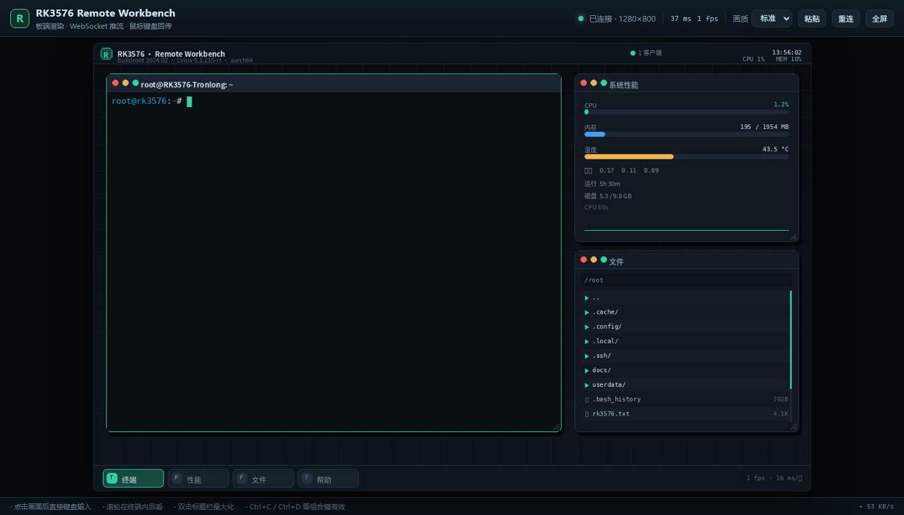

# RKDesk · RK3576 远程工作台

给没有显示器、键盘、鼠标的 RK3576 开发板做一个「浏览器里的桌面」：
**画面由板端自己渲染**，通过 WebSocket 把 JPEG 帧推到浏览器；鼠标、滚轮、键盘事件回传板端，
由板端窗口管理器和 PTY 终端处理。

它不依赖 X11 / Weston / VNC，也不需要往板端安装任何东西——只用板端已有的
Python 3.11 + Pillow。



## 为什么不是 VNC

这块 TL3576-EVM 运行的是 Tronlong Buildroot 2024.02：

- 没有 `vncserver` / `x11vnc` / `wayvnc`，也没有包管理器；
- 只有 DRM 后端，没有 VNC/headless 后端；
- 更关键的是，探测时发现 `/usr/bin/weston` 已经被写坏（只剩 56 字节的错误文本，
  不是可执行文件），所以无法再启动原来的 Weston 桌面。

RKDesk 因此把「桌面」放在板端进程里：窗口、终端、文件管理器、性能面板全部由
Pillow 画到内存位图，再编码成 JPEG 推流。浏览器只负责显示和采集输入。
这条路对当前镜像最稳，资源占用也低。

> ⚠️ `/usr/bin/weston` 的损坏不是本项目造成的（探测前就已存在）。恢复方法见文末。

## 快速开始

板端服务已经在跑：

```text
http://192.168.31.153:8088
```

浏览器打开即可。点击画面后可直接键盘输入，滚轮在终端里回看历史。

主机端重新部署（改完代码后）：

```bash
cd F:/data/RK3576/RKDesk
bash deploy.sh                 # 默认 root@192.168.31.153
```

板端服务管理：

```bash
ssh rk3576
/etc/init.d/S99rkdesk status
/etc/init.d/S99rkdesk restart
tail -f /var/log/rkdesk.log
```

> 端口说明：旧 MVP 的 `board_agent.py` 仍占用 `8765`（画面为全黑，已无用途）；
> RKDesk 使用 `8088`，两者互不影响。确认不再需要旧代理后可自行停止。

## 功能

- **终端**：真实 PTY（`/bin/sh -i`），支持 ANSI 颜色、光标、宽字符/中文、滚轮回看、
  Ctrl+C / Ctrl+D / 方向键 / F1-F12。
- **窗口管理**：拖动标题栏、右下角缩放、双击标题栏最大化、关闭/最小化。
- **性能面板**：CPU、内存、温度、负载、运行时间、磁盘、60 秒 CPU 曲线。
- **文件管理器**：浏览 `/root`、`/userdata` 等目录，点击文本文件直接预览。
- **浏览器工具栏**：画质（45–90）、全屏、粘贴剪贴板、重连、实时延迟/帧率/带宽。
- **多客户端**：共享同一个板端会话（和 VNC 一样）。
- **可选 Token**：`--token xxx` 后访问 `http://board:8088/?token=xxx`。

## 架构

```text
┌──────────────────────────── 浏览器 ────────────────────────────┐
│  canvas  ← JPEG 帧 (WebSocket binary)                          │
│  鼠标/键盘/滚轮 ── JSON (WebSocket text) ──┐                    │
└────────────────────────────────────────────┼───────────────────┘
                                             ▼
┌────────────────────────── RK3576 板端 ─────────────────────────┐
│  ThreadingHTTPServer + 自实现 WebSocket                        │
│    ├─ 渲染线程：Desktop.render() → JPEG（约 15 ms/帧）          │
│    ├─ 输入分发：窗口管理器 / 终端                               │
│    ├─ PTY：/bin/sh -i（TIOCSWINSZ 跟随窗口大小）                │
│    └─ 统计线程：/proc/stat、/proc/meminfo、thermal、statvfs     │
└────────────────────────────────────────────────────────────────┘
```

- 默认虚拟分辨率 **1280×800**（横向，适合桌面）。可用 `--width/--height` 改。
- 默认 12 fps、JPEG 质量 64；拖动窗口时约 600 KB/s，静止时约 50 KB/s（1 帧/秒心跳）。
- 服务常驻内存约 41 MB，CPU 平均约 12%（单核占比）。

## HTTP / WebSocket 接口

| 路径 | 说明 |
| --- | --- |
| `GET /` | Web 客户端 |
| `GET /healthz` | 服务状态（尺寸、客户端数、fps、编码耗时） |
| `GET /api/stats` | 板端 CPU/内存/温度/磁盘等 |
| `GET /api/screenshot.jpg` | 当前桌面单帧，便于脚本/文档使用 |
| `POST /api/paste` | 把请求体文本粘贴到当前终端 |
| `WS /ws` | 帧推流 + 输入事件 |

WebSocket 输入消息（JSON）：

```json
{"t":"move","x":300,"y":200}
{"t":"down","x":300,"y":200,"b":0}
{"t":"up","x":300,"y":200,"b":0}
{"t":"wheel","x":300,"y":200,"dy":-1}
{"t":"key","key":"Enter","ctrl":false,"alt":false}
{"t":"text","text":"echo hi\n"}
{"t":"paste","text":"..."}
{"t":"quality","value":78}
{"t":"ping","ts":123.4}
```

## 目录

```text
RKDesk/
├─ board/
│  ├─ rkdesk_server.py       # 入口
│  └─ rkdesk/
│     ├─ server.py           # HTTP / WebSocket / PTY / 帧循环
│     ├─ desktop.py          # 窗口管理器与全部绘制
│     └─ terminal.py         # VT100/xterm 解析与字符网格
├─ web/                      # 浏览器客户端（无构建步骤）
├─ deploy.sh                 # tar over SSH 部署
├─ deploy/S99rkdesk          # Buildroot init 脚本
├─ tools/
│  ├─ verify_env.py          # mlsys IDE 实验环境校验
│  ├─ ws_bench.js            # 帧率/带宽压测
│  └─ cdp_shot.js            # 无头浏览器截图
└─ docs/
   ├─ browser.png
   ├─ env-report.txt
   └─ mlsys-ide-setup.md
```

## 已知限制

- 只有一块共享桌面，多客户端会互相看到同一会话；没有多用户隔离。
- 视频/音频不做转发；当前也没有接摄像头和扬声器。
- 全屏 JPEG 推流，没有做分块脏区编码；12 fps 对终端足够，但不适合看视频。
- 默认无认证、无 TLS，仅限可信局域网；需要跨网请加 SSH 隧道或 `--token`。
- 这是「板端渲染的虚拟桌面」，不是 Weston 合成器的画面；原 Weston 恢复前，
  Qt/LVGL 等 Wayland 客户端无法显示。

## 恢复 Weston（可选）

`/usr/bin/weston` 现在只有 56 字节，内容是：

```text
/etc/init.d/S49weston: line 20: 11: Bad file descriptor
```

恢复方式（任选其一）：

1. 用 Tronlong 提供的同版本 Buildroot 镜像重新烧录，或从镜像的 rootfs 中取回
   `/usr/bin/weston`（Buildroot 2024.02 / Weston 14.0.1 / glibc 2.38）。
2. 从另一块同型号、同镜像的板子复制 `/usr/bin/weston`（约 163 KB，ELF aarch64）。
3. 恢复后执行 `/etc/init.d/S49weston start`，确认 `weston --version` 输出 14.0.1。

> 注意：不要把命令输出重定向到 `/usr/bin/weston`。这次损坏很可能就是类似
> `... | tee /usr/bin/weston` 的误操作导致的。

## 安全

这是局域网实验工具，默认监听 `0.0.0.0:8088`，没有账号密码。
不要把端口映射到公网；跨公网请用 SSH 隧道：

```bash
ssh -L 8088:127.0.0.1:8088 root@192.168.31.153
```

然后访问 `http://127.0.0.1:8088`。
