# RKDesk 系统说明：RK3576 真实屏幕远程工作台

> 版本：1.1.0  
> 日期：2026-11-04  
> 适用硬件：TL3576-MiniEVM（RK3576，aarch64）  
> 系统：Buildroot 2024.02 / Linux 6.1.115-rt16 / Weston 14.0.1 / PulseAudio 16.1

---

## 目录

1. [一页纸摘要](#一页纸摘要)
2. [目标、边界与约束](#目标边界与约束)
3. [总体架构](#总体架构)
4. [关键设计决策](#关键设计决策)
5. [视频链路：DRM/KMS 真实屏幕](#视频链路drmkms-真实屏幕)
6. [输入链路：绝对鼠标与键盘](#输入链路绝对鼠标与键盘)
7. [音频链路：PulseAudio 双向音频](#音频链路pulseaudio-双向音频)
8. [HTTPS 与浏览器安全上下文](#https-与浏览器安全上下文)
9. [部署、启动顺序与故障恢复](#部署启动顺序与故障恢复)
10. [C 版镜像：性能对比通道](#c-版镜像性能对比通道)
11. [性能度量与瓶颈分析](#性能度量与瓶颈分析)
12. [可靠性与安全边界](#可靠性与安全边界)
13. [限制与后续演进](#限制与后续演进)
14. [术语表](#术语表)

---

## 一页纸摘要

RKDesk 把 RK3576 开发板 **HDMI/DSI 上真实扫描输出的画面**镜像到 Windows 浏览器，
并把浏览器的鼠标、键盘、麦克风送进板端；同时把板端 PulseAudio 的系统播放送回浏览器。
它不是 VNC，也不是板端自绘 UI，而是直接从 **DRM/KMS CRTC framebuffer** 读取真实像素。

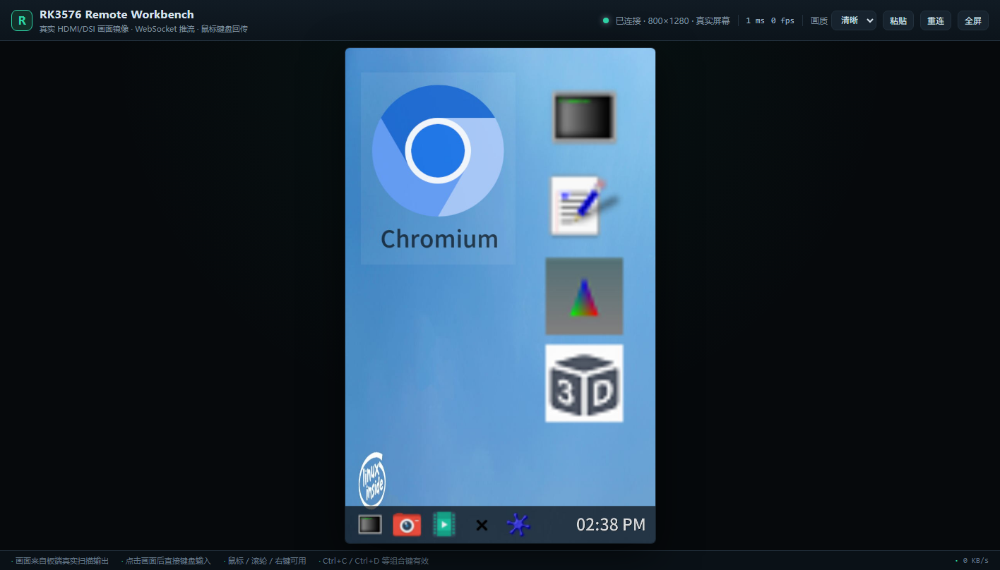

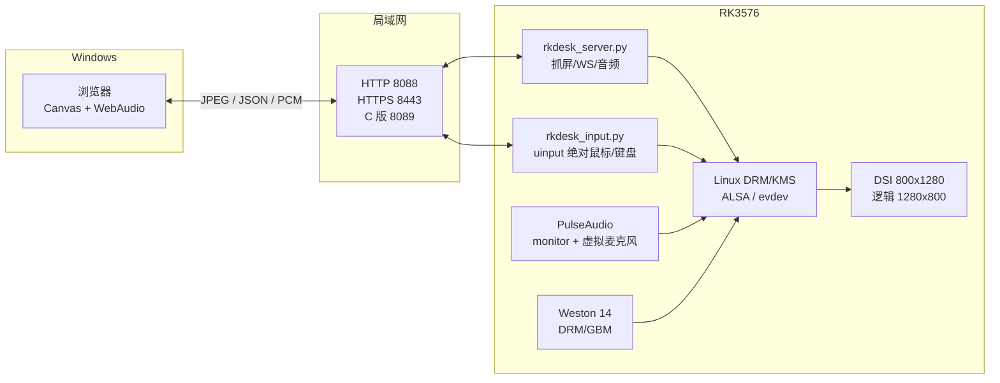

**核心数字**

| 指标 | Python 版（8088） | C 版（8089） |
| --- | --- | --- |
| 分辨率 | 1280×800 逻辑（原生 800×1280 rotate-90） | 同左 |
| 帧率 | 15.0 fps | 29.8 fps |
| 带宽 | 约 807 kbps（q78） | 约 1660 kbps（q78/4:2:2） |
| 服务端 encode | 15.9 ms | 20.7 ms |
| 进程 CPU | 64.8% | 64.3% |
| 进程 RSS | 52 MB | 7.8 MB |
| 音频 | 48 kHz PCM 双工 + 虚拟麦克风 | 无（仅画面/输入） |

---

## 目标、边界与约束

### 目标

1. **看到真实画面**：浏览器显示板端 HDMI/DSI 当前输出，而不是另画一套 UI。
2. **完整操作**：绝对鼠标、左右中键、滚轮、拖动、键盘、组合键。
3. **双向音频**：板端系统播放 → Windows；Windows 麦克风 → 板端虚拟麦克风。
4. **无额外依赖**：Buildroot 没有 VNC server/包管理器，尽量只用系统已有组件。
5. **可部署、可恢复**：开机自启、服务重启不破坏桌面、断线自动恢复。
6. **可解释的性能**：Python 版优先功能完整，C 版用于吞吐/资源对比。

### 非目标

- 不是多租户云桌面；默认单用户/可信局域网。
- 当前不做摄像头视频采集（硬件无 sensor；后续接 USB UVC 可扩展）。
- 不做互联网级认证/审计；跨网需 SSH 隧道或额外网关。
- C 版覆盖视频/输入/音频/HTTPS，但不处理 HDMI 热插拔与摄像头。

### 约束

| 约束 | 影响 | 应对 |
| --- | --- | --- |
| Buildroot 无 gcc/git/apt | 不能板端编译 | 主机 Zig 交叉编译；脚本随仓库部署 |
| `/dev/fb0` 全黑 | 传统 framebuffer 抓屏不可用 | DRM dma-buf |
| `weston-screenshooter` 返回 unauthorized | 不能走官方截屏协议 | 直接读 KMS scanout |
| DSI 原生 800×1280 竖屏 | 浏览器显示比例不对 | Weston `rotate-90` + 原始帧旋转 |
| 无扬声器/麦克风/摄像头 | 本地听不到声音 | Pulse monitor + 虚拟麦克风 + 测试音 |
| 浏览器 getUserMedia 需要安全上下文 | HTTP 不能用麦克风 | 自签名 HTTPS 8443 |
| 板端 Weston 只在启动时枚举输入设备 | 后建 uinput 不生效 | S48 输入守护先于 S49 Weston |
| 板端 1.9 GiB 可见内存 | 不能跑重型 WebRTC 服务 | PCM over WebSocket，无转码 |

---

## 总体架构

### 分层视图

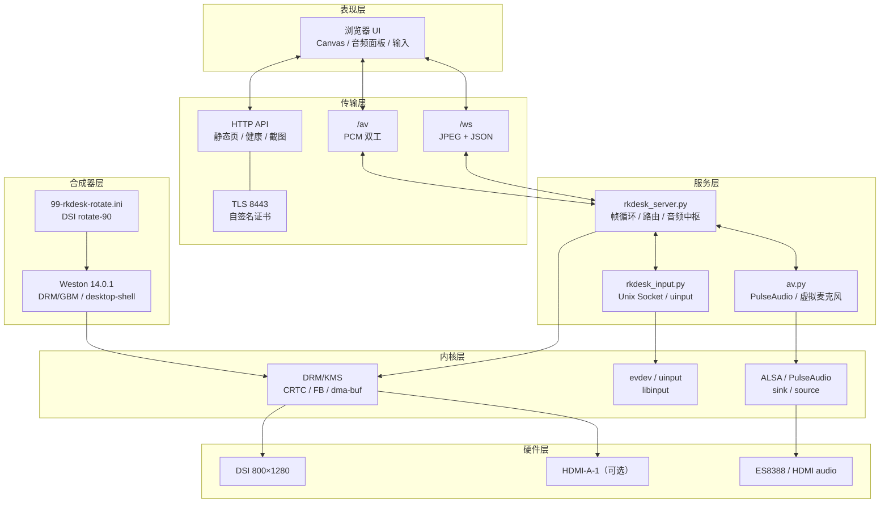

### 部署拓扑

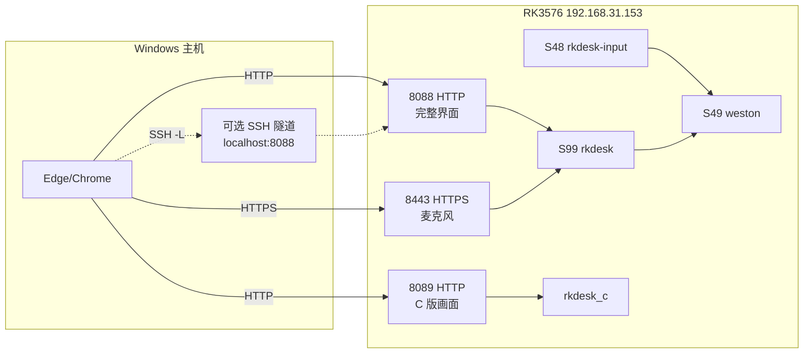

### 服务与端口

| 端口/服务 | 作用 | 启动方式 |
| --- | --- | --- |
| `8088/tcp` | Python 版完整界面（画面/输入；音频播放可用，麦克风受安全上下文限制） | `S99rkdesk` |
| `8443/tcp` | HTTPS 同源完整界面，浏览器麦克风/摄像头权限可用 | `S99rkdesk` 内置 TLS |
| `8089/tcp` | C 版画面/输入，性能对比 | 手动 `/opt/rkdesk/rkdesk_c` |
| `22/tcp` | SSH 部署/调试 | 系统 |
| `S48rkdesk-input` | 创建 uinput 绝对鼠标/键盘，Unix Socket 控制 | 开机 |
| `S49weston` | Weston 合成器 | 开机 |
| `S99rkdesk` | Python 抓屏 + WS + 音频 | 开机 |

### 数据平面

| 通道 | 协议 | 方向 | 负载 |
| --- | --- | --- | --- |
| 视频 | `/ws` binary | 板端→浏览器 | JPEG 帧（800×1280 或 1280×800） |
| 输入 | `/ws` text | 浏览器→板端 | JSON move/down/up/wheel/key/text |
| 音频下行 | `/av` binary | 板端→浏览器 | S16LE 48k 2ch，20 ms/3840 B |
| 音频上行 | `/av` binary | 浏览器→板端 | S16LE 48k 1ch，20 ms/1920 B |
| 音频控制 | `/av` text | 双向 | JSON status/audio_start/mic_start/test_tone |
| 控制/健康 | HTTP | 浏览器→板端 | `/healthz` `/api/av` `/api/stats` `/api/debug` |

---

## 关键设计决策

### 为什么不是 VNC

| 方案 | 结果 | 原因 |
| --- | --- | --- |
| `x11vnc`/`vncserver` | 不可用 | Buildroot 未安装，无包管理器 |
| `wayvnc` | 不可用 | 未编译，Weston 只有 DRM 后端 |
| `weston-screenshooter` | 不可用 | 普通客户端 `Output capture error: unauthorized` |
| 读 `/dev/fb0` | 全黑 | Weston 用 GBM 渲染，fbdev 是模拟层，不是真实 scanout |
| **DRM dma-buf** | **可用** | 直接读 CRTC 当前 framebuffer，真实像素 |

结论：远程桌面协议不是越“标准”越好，必须匹配板端可用的内核/合成器接口。

### 视频传输：JPEG over WebSocket

| 方案 | 优点 | 缺点 | 选择 |
| --- | --- | --- | --- |
| MJPEG HTTP | 实现最简单，`` 直接显示 | 无双向控制，帧边界/背压弱 | 否 |
| WebRTC | 低延迟、抗丢包、浏览器原生 | 板端需要 ICE/DTLS/SDP/编码器，复杂度高 | 未来 |
| **WS + JPEG** | 双向同连接、实现可控、局域网足够 | 带宽高于 H.264/Opus | **是** |
| 原始 RGB | 无编码延迟 | 3 MB/帧，不可用 | 否 |

### 输入：绝对指针而非相对鼠标

| 方案 | 结果 |
| --- | --- |
| 相对鼠标（REL_X/REL_Y） | 受指针加速/累积误差影响，无法 1:1 定位 |
| 手写板（tablet） | libinput 认成 tablet，桌面图标点击不生效 |
| **绝对鼠标（ABS_X/Y + BTN_LEFT + PROP_POINTER）** | libinput 报 `POINTER_MOTION_ABSOLUTE`，Weston 当 pointer，点击/拖动/右键正常 |

### 音频：PulseAudio monitor + null/remap

- 板端系统播放 → 默认 sink 的 `.monitor` source：`parec` 抓取；
- Windows 麦克风 → `rkdesk_mic` null sink：`pacat` 写入；
- `module-remap-source` 把 null sink 的 monitor 暴露成 `rkdesk_mic_source`；
- 麦克风启用时把默认录音源切到它，停止/崩溃后恢复。

### Python 与 C 双实现

- Python 版：功能完整（视频、输入、音频、HTTPS、热插拔恢复），开发效率高；
- C 版：视频 + 输入 + Pulse 音频 + TLS 8444，验证“去掉解释器/拷贝/旋转后的吞吐上限”；
- 二者共享同一个输入守护进程和同一块 DRM 屏幕，可同时运行对比。

---

## 视频链路：DRM/KMS 真实屏幕

### DRM/KMS 最小知识

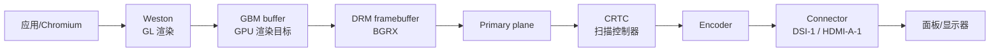

- **CRTC**：扫描输出控制器，决定当前 timing、framebuffer；
- **Framebuffer**：一块像素内存 + 格式 + pitch；
- **Plane**：图层，primary/cursor/overlay；
- **Encoder/Connector**：编码器与物理接口；
- **dma-buf / PRIME**：把 GPU/显示 buffer 以文件描述符导出，供其他进程 mmap。

### 抓帧时序

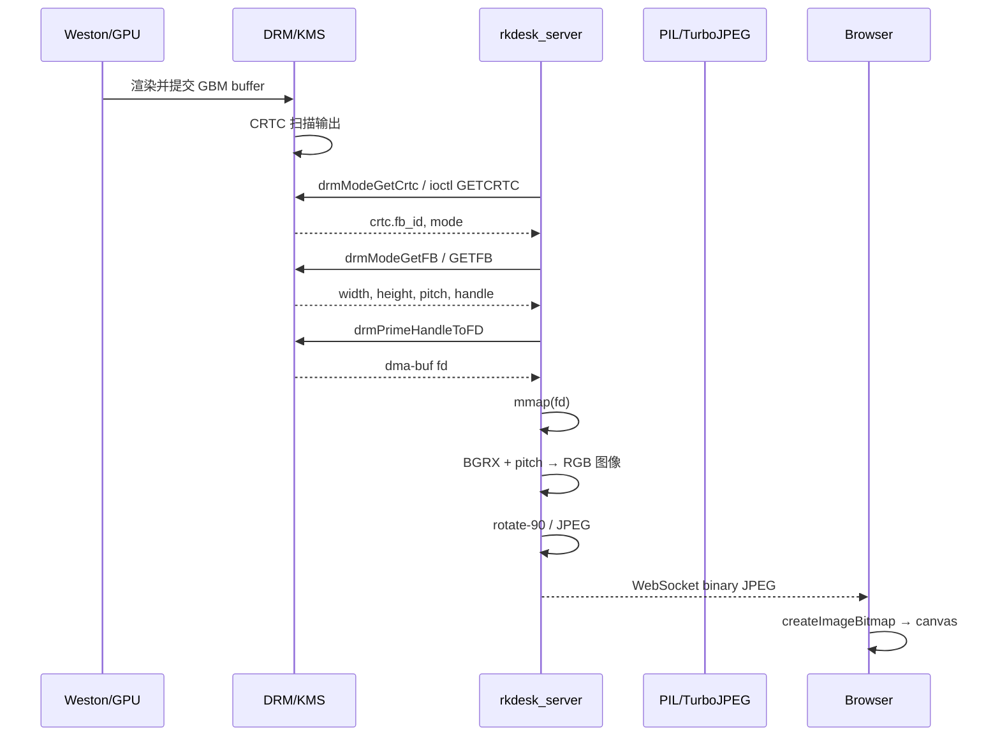

### 像素格式与 pitch

- Rockchip 输出为 **BGRX8888**（每像素 4 字节，X 忽略）；
- `pitch`（stride）通常 = `width * 4`，但不保证；必须按行跨度读取；
- Python：
  ```python
  Image.frombuffer("RGB", (width, height), mapped, "raw", "BGRX", pitch, 1)
  ```
- C：
  ```c
  tjCompress2(tj, map, width, pitch, height, TJPF_BGRX, ...)
  ```
  直接把带 pitch 的 BGRX 交给 TurboJPEG，避免额外拷贝。

### 旋转：原生 800×1280 → 逻辑 1280×800

DSI 面板原生 800×1280 竖屏，但桌面需要横向 1280×800：

1. Weston 配置 `transform=rotate-90`，逻辑输出变成 1280×800；
2. DRM 原始 buffer 仍是 800×1280，内容相对逻辑旋转了 90°；
3. Python 抓帧后 `rotate(-90)` 成 1280×800 再推流；
4. C 版不旋转，直接把 800×1280 JPEG 推给浏览器，由 Canvas GPU 旋转；
5. 输入坐标必须做逆变换（见下一节）。

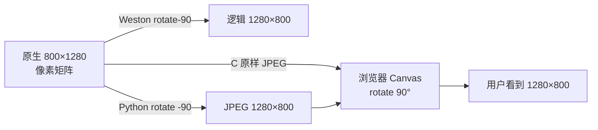

### 分辨率与 HDMI

- Python `MirrorSource` 每 2 秒重新选择 **面积最大的活动 CRTC**；
- 原生宽度 > 高度（HDMI 1920×1080）时强制 rotation=0，直接推流；
- 原生竖屏时读取 `wayland-info` 的 `output_transform` / `logical_width`；
- C 版固定按启动时 CRTC 抓取，不处理 HDMI 热插拔（对比通道的取舍）。

---

## 输入链路：绝对鼠标与键盘

### 设备与进程

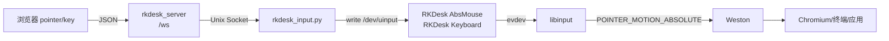

- `rkdesk_input.py` 在 **S48** 启动，早于 **S49 Weston**；
- 原因：Weston 只在启动时枚举输入设备，后创建的 uinput 不会自动出现在 seat；
- 服务端重启不会重启输入守护，因此不会关闭板端窗口；
- 只有重启输入守护才会重建 uinput 并重启 Weston。

### 绝对坐标逆变换（90° 旋转）

记：

- 逻辑/显示坐标：`(lx, ly)`，范围 1280×800；
- uinput 设备坐标：`(dx, dy)`，范围 1280×800（由守护进程 resize）；
- 原生坐标：800×1280。

Weston 把设备归一化坐标当作原生轴，再做 rotate-90：

```text
u = dx / 1280
v = dy / 800
lx = (1 - v) * 1280
ly = u * 800
```

反解：

```text
dx = ly * 1280 / 800 = 1.6 * ly
dy = (1 - lx / 1280) * 800 = 800 - 0.625 * lx
```

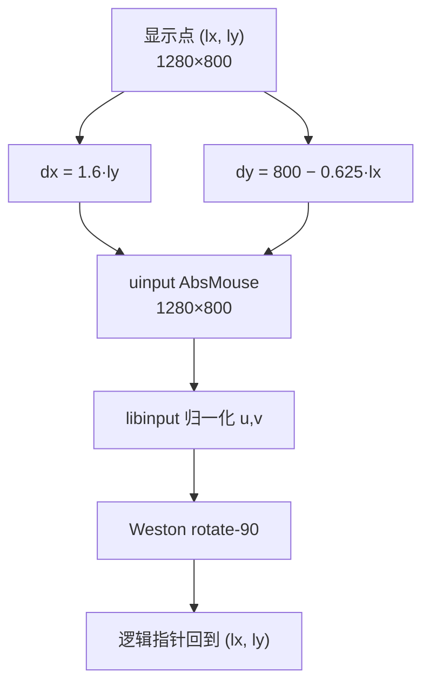

> 这是“设备范围 = 逻辑尺寸”时的公式；若原生尺寸/transform 改变，需要按同样方法重新推导。

### 键盘

- 浏览器特殊键（Enter/Backspace/Tab/方向键/F1–F12）→ `{t:"key"}`；
- 普通字符 → `{t:"text"}`，守护进程用 Linux keycode + Shift 逐字符输入；
- 支持 Ctrl/Alt/Shift/Meta 组合键；
- 中文输入依赖板端 IME，当前镜像无中文 IME，ASCII 正常；
- 快速连发需 4 ms 间隔，避免 Weston 丢键。

---

## 音频链路：PulseAudio 双向音频

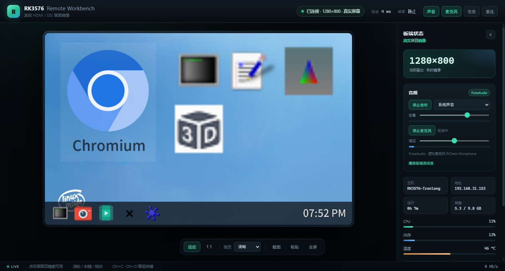

### PulseAudio 图模型

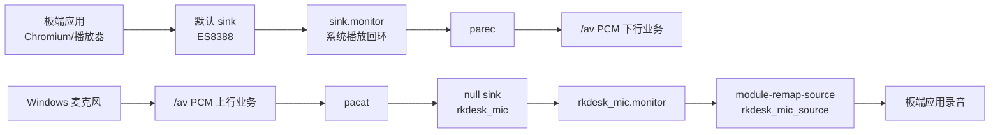

- **monitor** 是 sink 的回环 source，能捕获“所有播放”，不依赖物理扬声器；
- **null sink** 是虚拟播放设备，没有硬件输出；
- **remap source** 把 null sink 的 monitor 包装成普通录音源；
- 切换默认 source 后，新启动的板端应用会自动选择 `RKDesk Microphone`。

### 板端 → 浏览器

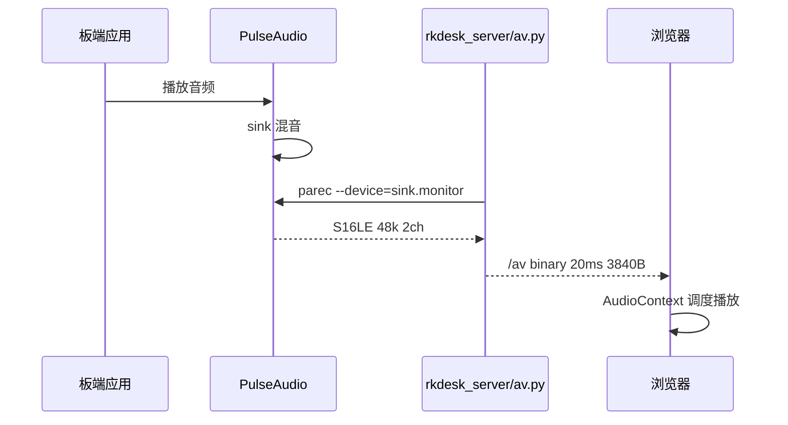

### 浏览器 → 板端

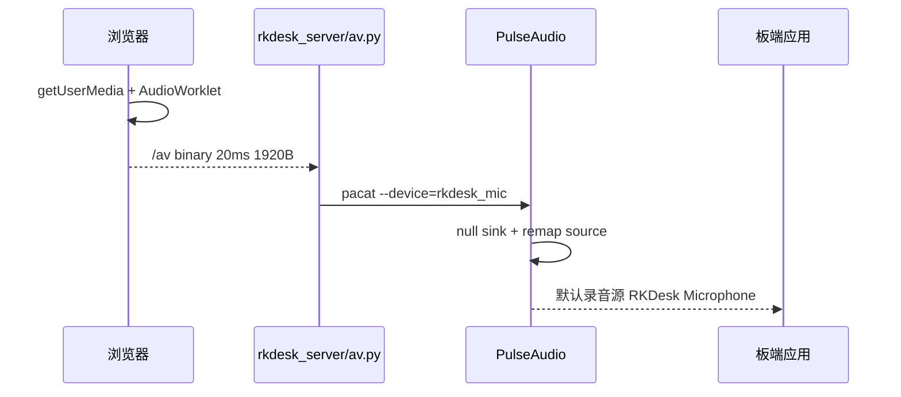

### 虚拟麦克风状态机

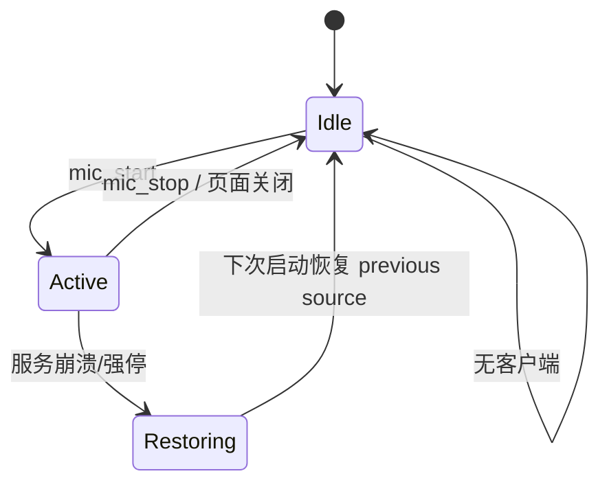

- 记录原默认 source 到 `/var/run/rkdesk-mic.previous`；
- 启动时若发现残留文件，先恢复原 source，再清理残留 module；
- 页面关闭/WS 断开：`remove_client` 停止虚拟麦克风；
- 服务被 `kill`：下次 `AVHub.__init__` 恢复。

### 音频格式与延迟

| 项 | 值 |
| --- | --- |
| 采样率 | 48000 Hz |
| 下行 | 2ch S16LE，20 ms = 3840 B |
| 上行 | 1ch S16LE，20 ms = 1920 B |
| 抓取缓冲 | `parec --latency-msec=30` |
| 浏览器播放缓冲 | 约 80 ms 调度窗口 |
| 端到端延迟 | 约 150–250 ms |

---

## HTTPS 与浏览器安全上下文

`getUserMedia`（麦克风/摄像头）要求 **secure context**：

- `https://` 或 `http://localhost` 才算安全；
- `http://192.168.31.153:8088` 不是安全上下文，浏览器会隐藏/拒绝 `mediaDevices`。

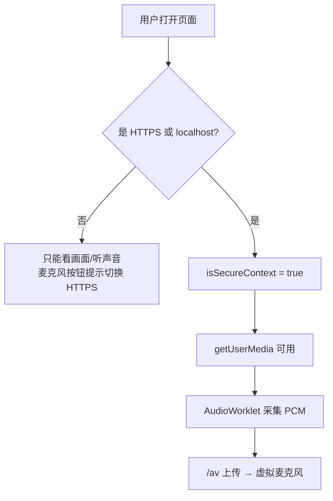

实现：

- `deploy.sh` 在主机用 `openssl` 生成带 SAN 的自签名证书；
- 安装到板端 `/opt/rkdesk/certs/rkdesk.crt|key`，私钥权限 600；
- Python `ssl.SSLContext` 在 8443 提供同源 HTTPS；
- 浏览器首次需手动信任；也可用 SSH 隧道访问 `http://localhost:8088`。

---

## 部署、启动顺序与故障恢复

### 启动顺序

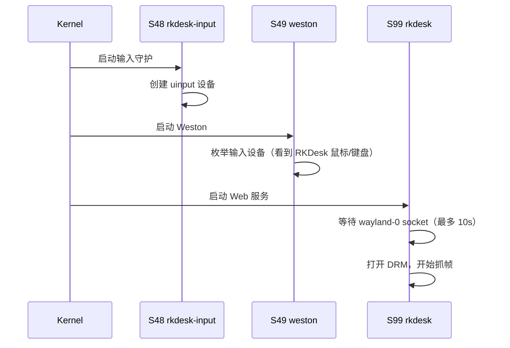

**关键竞态**：S99 启动时若 Weston 进程已存在但 socket 尚未创建，不能直接再
`S49weston start`，否则会启动第二个 Weston。正确做法是先等 socket，超时再判断进程。

### 部署流程

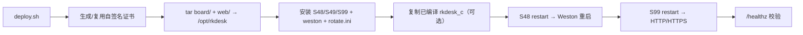

### Weston 修复

原始 `/usr/bin/weston` ELF 被写坏成 56 字节错误文本，但
`/usr/lib/weston/libexec_weston.so.0` 仍导出 `wet_main()`：

```python
lib = ctypes.CDLL("/usr/lib/weston/libexec_weston.so.0")
lib.wet_main.argtypes = [c_int, POINTER(c_char_p), c_void_p]
lib.wet_main(len(argv), array, None)
```

`S49weston` 的停止逻辑也必须按 `ps` 找 `python3 /usr/bin/weston`，因为
`killall weston` 匹配不到 Python 启动器。

---

## C 版镜像：性能对比通道

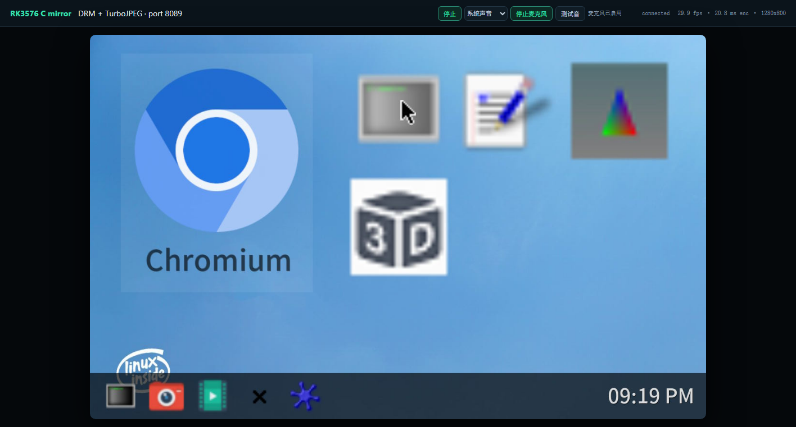

C 版同样提供 `/av`：

- 板端→浏览器：`parec` 抓默认 sink 的 monitor，PCM 48k/2ch；
- 浏览器→板端：`pacat` 写入 `rkdesk_c_mic` null sink，remap 为
  `rkdesk_c_mic_source`（RKDesk_C_Microphone）；
- HTTPS 8444 用板端已有 `libssl.so.3`/`libcrypto.so.3`，为 `getUserMedia` 提供安全上下文。

### 线程模型

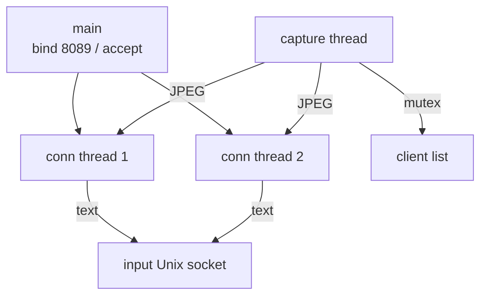

- `capture thread`：DRM mmap → TurboJPEG → 广播；
- 每个连接一个线程：HTTP 静态页 / `/healthz` / `/api/screenshot.jpg` / `/ws`；
- client list 用互斥锁；发送设置 `SO_SNDTIMEO`，避免慢客户端拖死采集；
- 无客户端时 `usleep(100ms)` 暂停编码（空闲 0% CPU）。

### C 抓帧

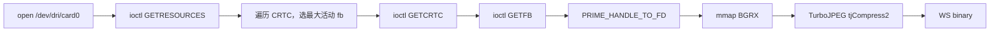

### 输入协议

C 页面发的是输入守护进程的原生协议：

```json
{"t":"move","x":400,"y":675}
{"t":"button","b":0,"down":true}
{"t":"button","b":0,"down":false}
{"t":"wheel","dy":1}
{"t":"key","key":"Enter",...}
{"t":"text","text":"..."}
```

不是 Python `/ws` 的 `down/up`（那是服务端负责翻译成 `move + button`）。

### 构建

- 主机无 gcc/交叉工具链；Bootlin Linux ELF 在 Windows 不能执行；
- 使用 **Zig Windows 0.13**：`zig cc -target aarch64-linux-gnu`；
- 链接板端 `libturbojpeg.so.0`（手写最小 TurboJPEG ABI 声明，不需要 dev 头文件）；
- 产物约 119 KB，动态链接 glibc + libturbojpeg + libssl/libcrypto。

---

## 性能度量与瓶颈分析

### 测量方法

- `ws_bench.js`：WebSocket 连接 6 秒，持续发送鼠标移动，统计帧数/字节数；
- `/healthz`：服务端 `fps`、`encode_ms`；
- `ps`：CPU/RSS；
- 质量统一 q78；C 使用 4:2:2，Python 使用 4:2:2（Pillow subsampling=1）。

### 数据

| 指标 | Python 8088 | C 8089 |
| --- | --- | --- |
| fps | 15.0 | **29.8** |
| kbps | 807 | 1660 |
| 平均帧 | 53.8 KB | 55.7 KB |
| encode | 15.9 ms | 20.7 ms |
| CPU | 64.8% | 64.3% |
| RSS | 52 MB | **7.8 MB** |

### 解释

- Python 每帧有解释器调度、Pillow 对象、抓帧拷贝/旋转等开销；
- C 直接 mmap + TurboJPEG，省掉旋转（浏览器 GPU 做），因此同 CPU 下帧率翻倍；
- C `encode_ms` 略高是测量口径与 4:2:2/实现差异，整体吞吐以 fps/CPU 为准；
- C 带宽翻倍是因为帧率翻倍，单帧大小接近；
- C 无客户端暂停，空闲 CPU 0%，避免常驻浪费。

---

## 可靠性与安全边界

### 可靠性设计

| 场景 | 机制 |
| --- | --- |
| 浏览器断线 | 前端 2 s 重连；服务端保留最新帧 |
| 输入守护重启 | 服务端 reader 检测 EOF，重连后先发 `resize` |
| 输入空闲 | 清除 1 s connect timeout，reader 阻塞等待 |
| 音频守护/服务崩溃 | `previous source` 文件恢复默认录音源；清理 module |
| Weston 启动竞态 | 先等 socket，超时才判断进程/重启 |
| 抓帧失败 | 重新打开 DRM，重试；Python 每 2 s 重选 CRTC |
| 静止画面 | 帧签名去重，不编码/不发送（0 KB/s） |

### 安全边界

- 默认无认证，监听 `0.0.0.0`；仅可信局域网。
- HTTPS 为自签名证书；首次需信任，不能防中间人。
- 跨网请用 SSH 隧道或前置反向代理 + 认证。
- 虚拟麦克风会切换板端默认录音源；停止后恢复。
- 输入注入等价于物理键鼠，能操作板端一切应用。

---

## 限制与后续演进

| 限制 | 现状 | 演进 |
| --- | --- | --- |
| 摄像头 | 未接入；无 sensor | USB UVC + OpenCV MJPEG/WS |
| 音频编码 | 裸 PCM | Opus/WebRTC，降带宽/延迟 |
| C 版功能 | 视频/输入/音频/HTTPS | 补 HDMI 热插拔、摄像头 |
| HDMI 热插拔 | Python 支持，C 不支持 | C 定时 refresh CRTC |
| 多用户 | 共享输入/屏幕 | 会话隔离、权限、审计 |
| 认证 | 无 | token、TLS 客户端证书、反代 |
| 中文输入 | 依赖板端 IME | 板端安装 IME 或远程输入法协议 |
| 延迟 | 150–250 ms 音频；视频 30–60 ms | WebRTC、硬件编码、零拷贝 |

---

## 术语表

| 术语 | 含义 |
| --- | --- |
| DRM/KMS | Direct Rendering Manager / Kernel Mode Setting，Linux 显示子系统 |
| CRTC | CRT Controller，扫描输出控制器 |
| Framebuffer | 一块带格式/pitch 的像素内存 |
| GBM | Generic Buffer Management，GPU/显示 buffer 分配接口 |
| dma-buf / PRIME | 跨设备/进程共享 GPU buffer 的文件描述符机制 |
| pitch/stride | 一行像素占用的字节数，可能大于 width×bpp |
| BGRX | 每像素 B,G,R,X 四字节，X 忽略 |
| Weston | Wayland 合成器 |
| transform=rotate-90 | 输出旋转 90°，逻辑尺寸与原生尺寸交换 |
| uinput | 用户态创建输入设备的 Linux 接口 |
| libinput | 输入设备抽象库，负责分类/校准/事件规范化 |
| POINTER_MOTION_ABSOLUTE | libinput 的绝对指针事件 |
| PulseAudio monitor | sink 的回环 source，可捕获播放 |
| null sink | 无硬件的虚拟播放设备 |
| remap source | 把 monitor 包装成普通录音源 |
| secure context | 浏览器安全上下文，HTTPS/localhost 才能用 getUserMedia |
| JPEG 4:2:0 / 4:2:2 | 色度子采样方式，影响体积/文字清晰度 |
| GIL | Python 全局解释器锁 |
| RSS | 进程常驻内存集 |
