# RKDesk 实现步骤与原理：从一块黑屏到可用远程工作台

> 面向：答辩、技术面试、接手开发的同学  
> 配套文档：[系统说明](ARCHITECTURE.md) · [面试问答](INTERVIEW_QA.md)  
> 代码版本：1.1.0（2026-11-04）

---

## 目录

1. [阅读指南与体系思维](#阅读指南与体系思维)
2. [阶段 0：环境探测与路线选择](#阶段-0环境探测与路线选择)
3. [阶段 1：恢复 Weston](#阶段-1恢复-weston)
4. [阶段 2：DRM 抓帧](#阶段-2drm-抓帧)
5. [阶段 3：帧服务与 WebSocket](#阶段-3帧服务与-websocket)
6. [阶段 4：绝对输入](#阶段-4绝对输入)
7. [阶段 5：旋转、比例与坐标](#阶段-5旋转比例与坐标)
8. [阶段 6：双向音频](#阶段-6双向音频)
9. [阶段 7：HTTPS 与浏览器权限](#阶段-7https-与浏览器权限)
10. [阶段 8：C 版实现与优化](#阶段-8c-版实现与优化)
11. [模块逐个拆解](#模块逐个拆解)
12. [协议、数据结构与公式](#协议数据结构与公式)
13. [问题复盘：15 个真实故障](#问题复盘15-个真实故障)
14. [测试与性能度量](#测试与性能度量)
15. [答辩速查：三分钟讲清系统](#答辩速查三分钟讲清系统)
16. [附录：文件、命令与检查表](#附录文件命令与检查表)

---

## 阅读指南与体系思维

这份文档不只列“做了什么”，而是按 **现象 → 定位 → 原理 → 修复 → 验证** 组织。
每一层都回答三个问题：

1. 这一层负责什么？
2. 它向上/向下暴露什么接口？
3. 出问题时，如何用最小实验把故障隔离在这一层？

### 五层模型

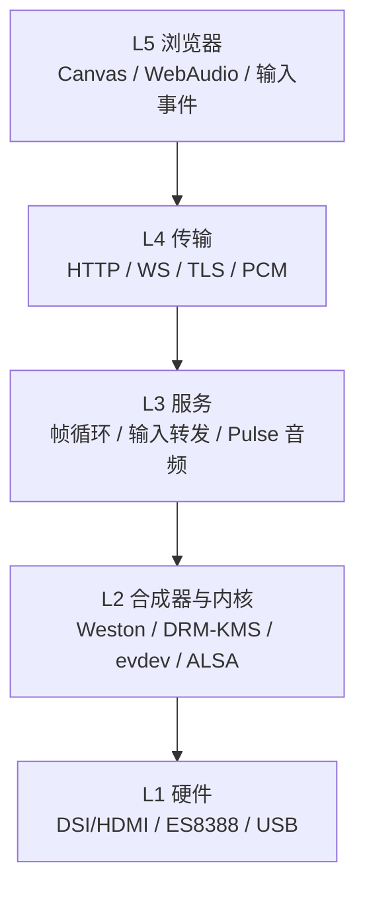

### 排查闭环

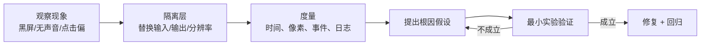

这套方法贯穿全文：不要一上来改代码，先做能**区分层**的实验。

---

## 阶段 0：环境探测与路线选择

### 探测命令

```bash
ssh root@192.168.31.153
uname -a
cat /proc/asound/cards
aplay -l; arecord -l
ls -l /dev/dri /dev/fb0 /dev/uinput
cat /sys/class/drm/card0-DSI-1/modes
ps -eo pid,args | grep -E 'weston|pulse|chromium'
```

### 实际发现

| 项 | 结果 | 影响 |
| --- | --- | --- |
| OS | Buildroot 2024.02，无 apt/gcc/git | 不能板端编译 |
| 显示 | DSI-1 800×1280，物理 94×150 mm | 竖屏，需旋转 |
| framebuffer | `/dev/fb0` 存在但全黑 | 不能读 fb0 |
| 截图 | `weston-screenshooter` unauthorized | 不能走官方截屏 |
| 输入 | `/dev/uinput` 可写 | 可注入键鼠 |
| 音频 | PulseAudio 16.1，ES8388 sink/source | 可做 monitor/虚拟麦克风 |
| 摄像头 | 无 sensor，只有 ISP/codec 节点 | 暂不做视频采集 |
| 编译器 | 无 gcc/cc1 | C 版需交叉编译 |

### 路线决策树

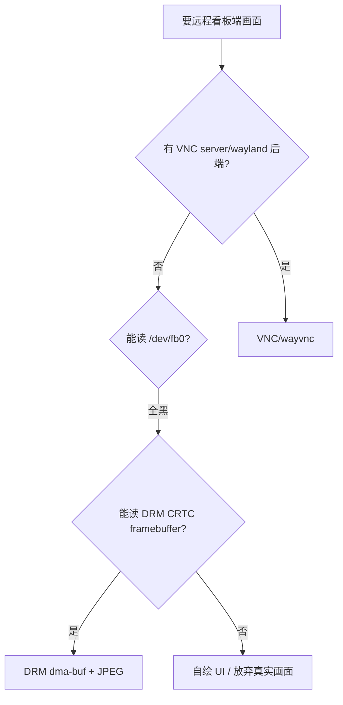

结论：**DRM/KMS** 是唯一能拿到真实 scanout 的路线。

---

## 阶段 1：恢复 Weston

### 现象

浏览器打开 8088 能连上，但抓屏全黑；`/var/log/weston.log`：

```text
/etc/init.d/S49weston: line 20: 11: Bad file descriptor
```

`/usr/bin/weston` 只有 56 字节，是错误文本，原 ELF 已丢失。

### 定位

```bash
file /usr/bin/weston
ls -l /usr/lib/weston/libexec_weston.so.0
nm -D /usr/lib/weston/libexec_weston.so.0 | grep wet_main
```

`libexec_weston.so.0` 仍导出 `wet_main()`，说明合成器逻辑还在，只缺入口。

### 修复

用 Python 启动器调用 `wet_main`：

```python
lib = ctypes.CDLL("/usr/lib/weston/libexec_weston.so.0")
lib.wet_main.argtypes = [ctypes.c_int, ctypes.POINTER(ctypes.c_char_p), ctypes.c_void_p]
lib.wet_main.restype = ctypes.c_int
argv = [b"weston"] + [arg.encode() for arg in sys.argv[1:]]
array = (ctypes.c_char_p * len(argv))(*argv)
sys.exit(lib.wet_main(len(argv), array, None))
```

同时修 `S49weston` 的停止逻辑：

```sh
for pid in $(ps -eo pid,args | awk '/python3 \/usr\/bin\/weston/ {print $1}'); do
    kill "$pid"
done
```

因为 `killall weston` 匹配不到 `python3 /usr/bin/weston`。

### 原理

- `wet_main` 是 Weston 的 C 入口，负责解析命令行、初始化后端、进入主循环；
- 用 `ctypes` 调用时，`argc/argv` 必须按 C ABI 构造；
- 启动器保持 `argv[0]="weston"`，否则 Weston 可能按错误名字查找资源。

### 验证

```bash
ps -eo pid,args | grep '[p]ython3 /usr/bin/weston'
cat /sys/class/drm/card0-DSI-1/status
```

### 别踩的坑

- 不要再把命令输出重定向到 `/usr/bin/weston`；
- 修复后要用 `S49weston restart` 验证停止/启动都能工作。

---

## 阶段 2：DRM 抓帧

### 目标

从当前 CRTC 的 framebuffer 拿到一帧 BGRX，保存为 JPEG/PNG，确认是真实桌面。

### Python 实现

`board/rkdesk/drm.py`：

```python
res = lib.drmModeGetResources(fd)
for crtc_id in res.crtcs:
    crtc = lib.drmModeGetCrtc(fd, crtc_id)
    if crtc.buffer_id and crtc.width * crtc.height > best:
        best = crtc_id

fb = lib.drmModeGetFB(fd, crtc.buffer_id)
prime = drmPrimeHandleToFD(fd, fb.handle)
mapped = mmap.mmap(prime.fd, fb.pitch * fb.height, PROT_READ, MAP_SHARED)
image = Image.frombuffer("RGB", (fb.width, fb.height), mapped, "raw", "BGRX", fb.pitch, 1).copy()
```

### C 实现

`c-src/rkdesk_c.c` 直接用 ioctl：

```c
ioctl(fd, DRM_IOCTL_MODE_GETRESOURCES, &res);
ioctl(fd, DRM_IOCTL_MODE_GETCRTC, &crtc);
ioctl(fd, DRM_IOCTL_MODE_GETFB, &fb);
ioctl(fd, DRM_IOCTL_PRIME_HANDLE_TO_FD, &prime);
void *map = mmap(NULL, fb.pitch * fb.height, PROT_READ, MAP_SHARED, prime.fd, 0);
```

### 时序

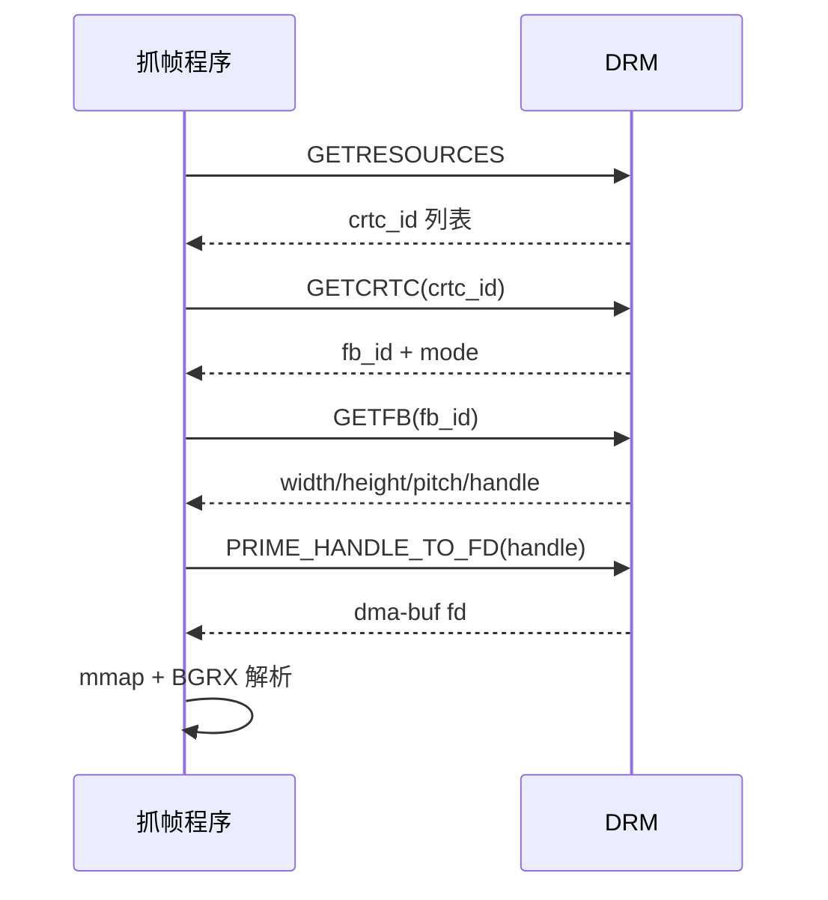

### 为什么不是 `/dev/fb0`

- Weston 使用 GBM/EGL 渲染到 **GBM buffer**，再通过 KMS plane 扫描；
- fbdev 是兼容层，不跟踪 GBM 的 scanout，读出来是黑/旧内容；
- KMS CRTC 的 `fb_id` 才是当前真正扫描的 buffer。

### 为什么要 pitch

`pitch` 是每行字节数，可能大于 `width*4`（对齐）。如果按 `width*4` 读，图像会斜切。
Pillow 的 `frombuffer(..., "BGRX", pitch, 1)` 和 TurboJPEG 的 `pitch` 参数都是为此。

### 验证

```bash
curl -s http://192.168.31.153:8088/api/screenshot.jpg -o /tmp/s.jpg
```

查看图片能识别 Chromium/终端图标。

---

## 阶段 3：帧服务与 WebSocket

### 目标

浏览器实时显示 JPEG，静止时不浪费带宽。

### 服务端结构

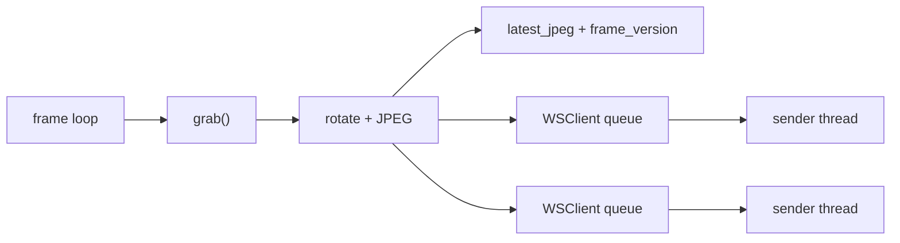

- `WSClient` 有一个 **maxsize=3** 的发送队列；
- 队列满时丢最旧帧，保证延迟不累积；
- 每帧在独立 sender 线程发送，避免慢客户端阻塞抓帧；
- `frame_version` 用于客户端诊断。

### 静态省流

```python
signature = hashlib.blake2b(mapped, digest_size=10).digest()
if signature == self.last_signature:
    return None
```

抓帧前对 mmap 做 BLAKE2b，签名相同就不编码、不发送；桌面静止时带宽为 0。

### 前端解码

`web/app.js`：

```js
if (window.createImageBitmap) {
  const bitmap = await createImageBitmap(blob);
  setFrameSize(bitmap.width, bitmap.height);
  ctx.drawImage(bitmap, 0, 0);
  bitmap.close();
}
```

`createImageBitmap` 在浏览器/GPU 侧解码，比 `new Image()` 更适合连续帧。

### 背压

如果编码/网络慢：

- 服务端队列丢旧帧；
- 前端 `pendingFrame` 只保留最新一帧；
- 结果是“跳帧但追最新”，而不是延迟越积越大。

---

## 阶段 4：绝对输入

### 目标

浏览器坐标 1:1 映射到板端，点击/拖动/右键/滚轮/键盘可用。

### 设备创建

`board/rkdesk/input.py`：

```python
UI_DEV_SETUP = 0x405C5503
UI_ABS_SETUP = 0x401C5504
```

`uinput_setup` 的字段顺序是：

```c
struct uinput_setup {
    struct input_id id;
    char name[80];
    __u32 ff_effects_max;
};
```

不是 `name` 在前。写错会导致设备名被截断（我们曾看到 “ablet”/“eyboard”）。

`UI_ABS_SETUP` 必须带 `resolution`，否则 libinput 会丢弃 tablet：

```python
struct.pack("H2x6i", code, 0, min, max, 0, 0, resolution)
```

64 位 `input_event` 是 24 字节（两个 8 字节 timeval），不能用 `llHHi`：

```python
struct.pack("<qqHHi", sec, usec, type, code, value)
```

### 设备类型选择

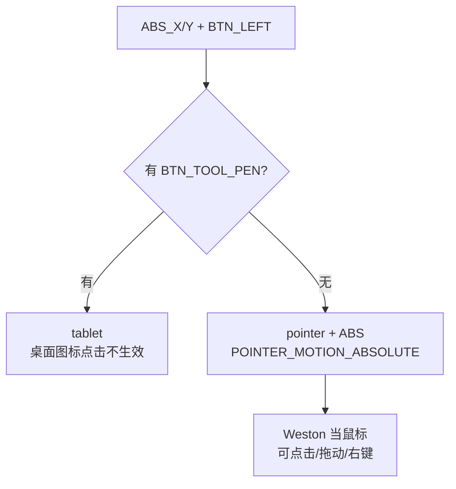

我们实测：tablet 能移动光标，但点击桌面图标不生效；最终选择 **绝对鼠标**。

### 坐标映射

显示 1280×800，原生 800×1280，Weston rotate-90：

```text
dx = 1.6 * ly
dy = 800 - 0.625 * lx
```

完整推导见 [ARCHITECTURE.md 输入链路](ARCHITECTURE.md#输入链路绝对鼠标与键盘)。

### 输入守护进程

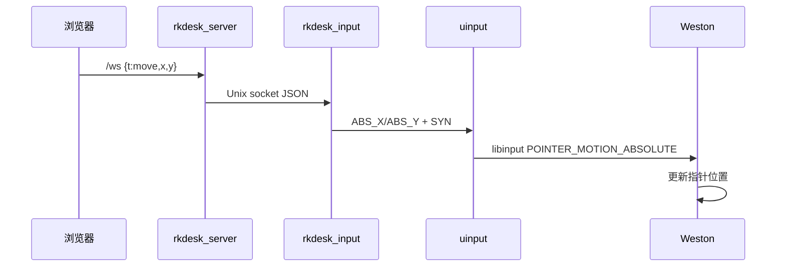

守护进程独立的好处：

- 服务端重启不重建设备，不关闭板端窗口；
- 多个服务（Python/C）可以共享同一套键鼠；
- 设备生命周期与 Weston 启动顺序解耦。

### 键盘

- 特殊键：`{t:"key", key:"Enter", ctrl:...}`；
- 普通字符：`{t:"text", text:"uname -a\n"}`；
- 逐字符发送 keycode，Shift 用于大写/符号；
- 4 ms 间隔避免丢键。

---

## 阶段 5：旋转、比例与坐标

### 现象

浏览器显示 800×1280 竖屏，但期望 1280×800 横向；鼠标能覆盖部分区域，但跳过 Chromium、底部菜单。

### 三层原因

1. **物理/逻辑方向**：DSI 原生 800×1280，需要 Weston `rotate-90`；
2. **抓帧方向**：原始 buffer 仍竖屏，需要旋转后显示；
3. **输入方向**：旋转后设备轴与逻辑轴交换/翻转，必须逆变换。

### Weston 配置

`/etc/xdg/weston/weston.ini.d/99-rkdesk-rotate.ini`：

```ini
[output]
name=DSI-1
transform=rotate-90
```

`wayland-info` 验证：

```text
logical_width: 1280, logical_height: 800
output_transform: 90°
mode: 800x1280
```

### 三种旋转方案

| 方案 | 结果 |
| --- | --- |
| 只在浏览器 CSS 旋转 | UI 仍然按竖屏布局，文字/图标位置不对 |
| 只在 C/Python 旋转 | 逻辑桌面仍是竖屏，布局不对 |
| **Weston rotate-90 + 抓帧旋转/浏览器旋转** | **逻辑桌面 1280×800，布局正确** |

### 坐标公式

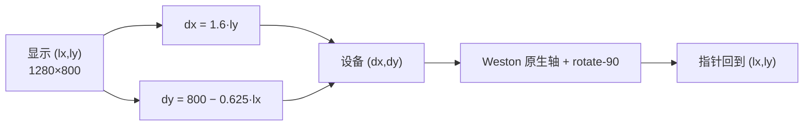

### 验证

- 四角 `(20,20)`、`(1260,20)`、`(20,780)`、`(1260,780)` 可达；
- 点 Chromium 图标能打开；
- 底部终端按钮能打开；
- 浏览器窗口和板端光标位置一致。

---

## 阶段 6：双向音频

### 目标

- 板端系统播放 → Windows 浏览器；
- Windows 麦克风 → 板端虚拟麦克风；
- 无物理扬声器/麦克风也能验证。

### PulseAudio 探测

```bash
pactl info
pactl list short sinks
pactl list short sources
```

实际：

```text
sink:   alsa_output.0.HiFi__hw_rockchipes8388__sink
source: ...sink.monitor
source: alsa_input.0.HiFi__hw_rockchipes8388__source
```

`pactl`、`parec`、`pacat`、`paplay` 都存在；`openssl` 不在板端，证书在主机生成。

### 下行（板端→浏览器）

```bash
parec --device=<sink>.monitor --format=s16le --rate=48000 --channels=2 --raw --latency-msec=30
```

服务端每 20 ms 读 3840 字节，广播到 `/av` 客户端；浏览器 AudioContext 调度播放。

### 上行（浏览器→板端）

```bash
pactl load-module module-null-sink sink_name=rkdesk_mic \
  sink_properties=device.description=RKDesk_Microphone
pactl load-module module-remap-source master=rkdesk_mic.monitor \
  source_name=rkdesk_mic_source \
  source_properties=device.description=RKDesk_Microphone
pactl set-default-source rkdesk_mic_source
pacat --device=rkdesk_mic --format=s16le --rate=48000 --channels=1 --raw
```

### 状态机

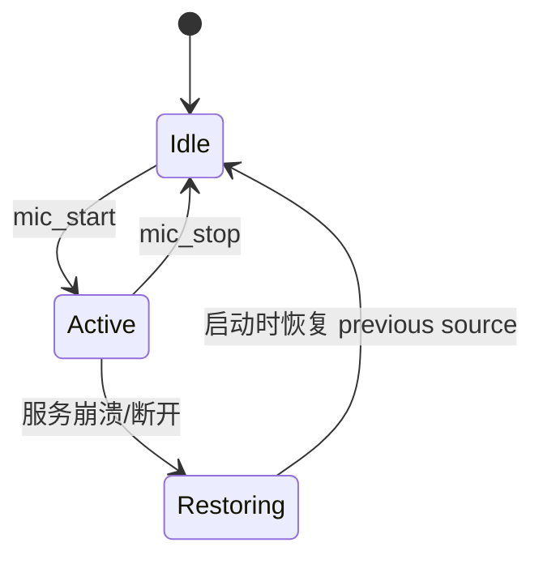

- 原默认 source 写 `/var/run/rkdesk-mic.previous`；
- 启动时恢复并清理残留 module；
- 页面关闭/WS 断开自动停止虚拟麦克风；
- 默认 source 恢复后，板端应用重新打开录音即可。

### 浏览器侧

- `getUserMedia` 采集麦克风；
- `AudioWorklet` 每 960 帧（20 ms）转 Int16，WebSocket 二进制上传；
- 下行用 `AudioBufferSourceNode` + `nextTime` 调度，避免音符重叠/断裂；
- 需要 HTTPS（secure context）。

### 无硬件验证

- 板端 `paplay` 测试音 → monitor 抓取 → `/av` 峰值 2810；
- Node 发 PCM → `pacat` → `parec rkdesk_mic_source` 峰值 10950；
- 无头 Edge 假麦克风 → 板端峰值 32683；
- 强停/关闭页面后默认 source 自动恢复。

---

## 阶段 7：HTTPS 与浏览器权限

### 为什么必须 HTTPS

`navigator.mediaDevices.getUserMedia` 只在 **secure context** 可用：

- `https://`；
- `http://localhost`；
- 其他 `http://IP` 不是安全上下文。

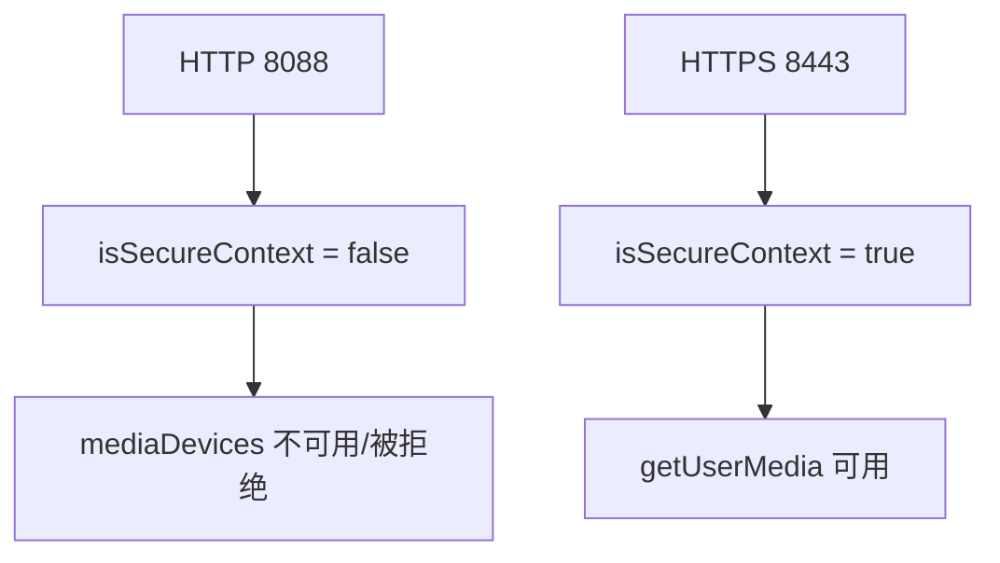

### 实现

- 主机 `openssl` 生成带 SAN 的自签名证书：

```bash
openssl req -x509 -newkey rsa:2048 -nodes \
  -keyout rkdesk.key -out rkdesk.crt -days 3650 \
  -subj "/CN=rk3576" \
  -addext "subjectAltName=IP:192.168.31.153,DNS:rk3576"
```

- `deploy.sh` 安装到 `/opt/rkdesk/certs`，私钥 600；
- Python `SSLContext` 在 8443 启动第二个 `ThreadingHTTPServer`；
- HTTP 8088 保留，用于不需要麦克风的场景；
- 页面根据 `window.isSecureContext` 显示“切换到 HTTPS”链接。

### 证书信任

- 首次打开 8443 会有自签名警告：高级 → 继续；
- 如果浏览器仍禁用麦克风：
  - 导入证书到 Windows 根信任：
    ```bat
    certutil -addstore -user Root RKDesk\deploy\certs\rkdesk.crt
    ```
  - 或 SSH 隧道：
    ```bash
    ssh -L 8088:127.0.0.1:8088 root@192.168.31.153
    ```
    打开 `http://localhost:8088`（localhost 是安全上下文）。

---

## 阶段 8：C 版实现与优化

### 为什么要 C

Python 版功能完整，但每帧有解释器/对象/拷贝开销。C 版用来回答：

> 如果去掉 Python 层，只保留 DRM + JPEG + WS，吞吐能到多少？

### 工具链问题

- 主机无 gcc/clang/交叉工具链；
- Bootlin aarch64 是 **Linux ELF**，Windows Git Bash 不能执行；
- 最终方案：**Zig Windows 0.13** `zig cc -target aarch64-linux-gnu`；
- 链接板端 `libturbojpeg.so.0`，手写最小 TurboJPEG ABI 声明，不需要 dev 头文件。

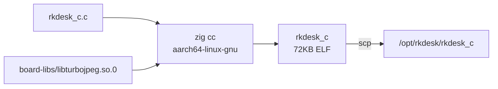

### C 抓帧

- 直接 `ioctl`，不依赖 libdrm；
- `PRIME_HANDLE_TO_FD` + `mmap`；
- TurboJPEG 直接读 BGRX + pitch。

### 关键优化：不在 C 里旋转

第一版 C 自己逐像素做 90° 旋转，`encode_ms=44 ms`，只有 23 fps。

原因：旋转是 **跨步访问**（读源列、写目标行），1M 像素的缓存不友好循环。

修复：

- C 只编码原生 800×1280；
- 浏览器 Canvas `translate + rotate(π/2)` 在 GPU 上旋转；
- `encode_ms` 降到约 20 ms，30 fps。

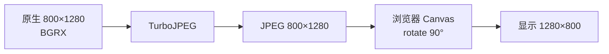

### 输入协议

C 页面一开始发送 `down/up`（Python 服务端协议），但输入守护只认 `move/button`，
所以点击被忽略。修复：

```json
{"t":"move","x":400,"y":675}
{"t":"button","b":0,"down":true}
{"t":"button","b":0,"down":false}
```

并且按下/抬起之间加 25/60 ms，避免 Weston 还没应用 move 就收到 button。

### 空闲暂停

C 第一版无客户端也 30fps 编码，CPU 64%。修复：

```c
if (!has_clients) {
    g_fps = 0;
    usleep(100000);
    continue;
}
```

空闲 CPU 0%，RSS ~1 MB。

### 实测

| 指标 | Python | C |
| --- | --- | --- |
| fps | 15.0 | 29.8 |
| kbps | 807 | 1660 |
| 帧大小 | 53.8 KB | 55.7 KB |
| encode | 15.9 ms | 20.7 ms |
| CPU | 64.8% | 64.3% |
| RSS | 52 MB | 1.7 MB |

---

## 模块逐个拆解

### `board/rkdesk/server.py`

| 模块 | 责任 |
| --- | --- |
| `WSClient` | 视频 WS 客户端；发送队列 maxsize=3；独立 sender 线程 |
| `AudioClient` | `/av` 客户端；队列 maxsize=24；低延迟丢旧包 |
| `App` | 帧循环、客户端管理、输入路由、音频中枢、HTTPS |
| `Handler` | HTTP 路由、静态文件、WebSocket 握手/读帧 |
| `main` | 参数、HTTP/HTTPS 双服务器、优雅关闭 |

关键点：

- `add_client` 发 hello + 最新帧，保证新页面立即出画；
- 帧循环在 mirror 模式用 `MirrorSource.grab()`，virtual 模式用 `Desktop.render()`；
- `handle_message` 在 mirror 模式把输入转给 `MirrorSource`，Python 负责把
  `down/up` 翻译成 `move + button`；
- `/av` 与 `/ws` 共用 `_begin_websocket` 握手，但客户端类型不同。

### `board/rkdesk/mirror.py`

| 模块 | 责任 |
| --- | --- |
| `InputClient` | Unix socket 长连接；reader 检测 EOF；重连先发 resize |
| `MirrorSource` | DRM 抓帧、几何检测、旋转、坐标反变换 |
| `_query_geometry` | 解析 `wayland-info` 的 transform/logical size |
| `_ensure_weston` | 启动竞态：先等 socket，超时再判断进程 |
| `move` | 显示坐标 → 设备坐标公式 |

`InputClient` 的两个关键修复：

1. **connect timeout 1s**：连接后必须 `settimeout(None)`，否则空闲 1s reader 就断开；
2. **重连 resize**：输入守护默认 800×1280，重连不重发 `resize 1280×800` 会导致坐标比例错。

### `board/rkdesk/drm.py`

- ctypes 定义 `drmModeRes/Crtc/FB` 结构；
- `_find_crtc` 选最大活动 CRTC；
- `grab` 导出 dma-buf、mmap、BLAKE2b 签名、BGRX→RGB；
- `refresh` 支持 HDMI 热插拔每 2s 重选。

### `board/rkdesk/input.py`

- `UInput`：打开 `/dev/uinput`、设置 evbit/keybit/absbit/relbit/propbit；
- `_setup_device`：`UI_DEV_SETUP` + `UI_ABS_SETUP`；
- `AbsMouse`：绝对坐标 + 左右中键 + 滚轮；
- `Keyboard`：全键码、`type_text` 处理 Shift/大写/符号；
- 64 位 `input_event` 用 `qqHHi`。

### `board/rkdesk_input.py`

- 创建 `VirtualInput`（AbsMouse + Keyboard）；
- 监听 `/var/run/rkdesk-input.sock`；
- 行分隔 JSON 命令：`move/button/wheel/key/text/resize`；
- 只记录非 move 命令，避免 60Hz 日志刷屏；
- 启动时如果 Weston 已运行且 socket 较旧，重启 Weston 让设备被枚举。

### `board/rkdesk/av.py`

| 模块 | 责任 |
| --- | --- |
| `Pulse` | 探测 pactl 环境、源列表、默认 sink/source、module 管理 |
| `VirtualMic` | null sink + remap source + pacat；默认源保存/恢复 |
| `AudioCapture` | parec/arecord 抓 PCM；精确读 3840 字节 |
| `AVHub` | 客户端集合、上下行路由、状态、测试音 |

关键点：

- `AudioCapture._read_exact` 必须循环读，pipe 可能短读；
- `VirtualMic.restore_if_crashed` 处理强停残留；
- `mic_owner` 跟踪谁开了麦克风，owner 断开就停止；
- 无 Pulse 时降级为 ALSA（只读抓取/扬声器播放，虚拟麦克风不可用）。

### `web/app.js`

- WebSocket 连接/重连；
- `createImageBitmap` 解码；
- `fitCanvas` 适配/1:1；
- 指针坐标 → canvas 像素；
- 键盘/IME/粘贴；
- `document` 级 pointermove，经过 dock 也不冻结；
- 截图/画质/全屏。

### `web/av.js`

- `/av` 连接（wss on HTTPS）；
- 下行 PCM → AudioBuffer 调度；
- 上行 `getUserMedia` + AudioWorklet；
- 音量/增益/电平；
- HTTPS 提示/切换；
- 麦克风失败自动停止。

### `c-src/rkdesk_c.c`

| 模块 | 责任 |
| --- | --- |
| DRM init | 直接 ioctl 选 CRTC/FB/prime/mmap |
| `encode_frame` | TurboJPEG 原生 BGRX → JPEG |
| `capture_loop` | 目标 fps、广播、空闲暂停、fps/encode 统计 |
| `SHA1/base64` | WS 握手 |
| `conn_thread` | 静态页/健康/截图/WS + 输入转发 |
| `PAGE` | 内嵌浏览器页面，Canvas 旋转/输入映射 |
| `input_forward` | Unix socket 重连 + resize |

### 部署脚本

- `deploy.sh`：tar over SSH；证书生成；S48/S49/S99 安装；C 二进制可选复制；
- `S48rkdesk-input`：先于 Weston；
- `S49weston`：启动器 + 停止逻辑；
- `S99rkdesk`：HTTP + HTTPS；
- `99-rkdesk-rotate.ini`：DSI 旋转；
- `verify_board.sh`：19 个文件 MD5 对比。

---

## 协议、数据结构与公式

### HTTP

| 路径 | 方法 | 返回 |
| --- | --- | --- |
| `/` | GET | 前端页面 |
| `/healthz` | GET | 版本/分辨率/clients/fps/encode/audio/https |
| `/api/av` | GET | Pulse/源/虚拟麦克风状态 |
| `/api/stats` | GET | CPU/内存/温度/磁盘 |
| `/api/debug` | GET | mirror rotation/geometry/input 状态 |
| `/api/screenshot.jpg` | GET | 最新 JPEG |

### `/ws` 输入消息

```json
{"t":"move","x":300,"y":200}
{"t":"down","x":300,"y":200,"b":0}
{"t":"up","x":300,"y":200,"b":0}
{"t":"wheel","x":300,"y":200,"dy":-1}
{"t":"key","key":"Enter","ctrl":false,"alt":false,"shift":false}
{"t":"text","text":"uname -a\n"}
{"t":"quality","value":78}
{"t":"ping","ts":123.4}
```

### `/av` 消息

文本：

```json
{"t":"audio_start","source":"...monitor"}
{"t":"audio_stop"}
{"t":"mic_start"}
{"t":"mic_stop"}
{"t":"test_tone"}
{"t":"status"}
```

二进制：

- 下行 3840 B/20 ms（2ch）；
- 上行 1920 B/20 ms（1ch）。

### 坐标公式

```text
dx = ly * 1280 / 800
dy = (1 - lx / 1280) * 800
```

### 帧签名

```python
sig = blake2b(mmap, digest_size=10).digest()
```

### 音频恢复文件

```text
/var/run/rkdesk-mic.previous
```

---

## 问题复盘：15 个真实故障

### 1. 抓屏全黑

- **现象**：`/frame.jpg` 全黑。
- **定位**：`/dev/fb0` 读出来全黑；`weston-screenshooter` unauthorized。
- **根因**：Weston 用 GBM，fbdev 是模拟层。
- **修复**：DRM CRTC framebuffer + dma-buf。
- **原理**：KMS scanout 与 fbdev 是两条路径。

### 2. Weston 起不来

- **现象**：`S49weston` 报 Bad file descriptor。
- **根因**：`/usr/bin/weston` ELF 被写坏成 56 字节。
- **修复**：`libexec_weston.so.0` 的 `wet_main` 启动器；修 stop 逻辑。
- **原理**：ELF 入口丢失但共享库逻辑仍在。

### 3. 长宽比反了

- **现象**：浏览器竖屏 800×1280。
- **根因**：DSI 原生竖屏；逻辑桌面未旋转。
- **修复**：Weston `transform=rotate-90`；抓帧旋转；输入逆变换。
- **原理**：输出 transform 改变逻辑坐标系，不改变原生 buffer 尺寸。

### 4. 手写板点不动桌面图标

- **现象**：tablet 能移动光标，点击图标无反应。
- **根因**：libinput 把手写板当 tablet tool，desktop-shell 不按 pointer 处理。
- **修复**：改用绝对鼠标（ABS + BTN_LEFT + PROP_POINTER）。
- **原理**：libinput 设备分类决定 Weston 的事件路径。

### 5. uinput 报 EINVAL / 设备名截断

- **现象**：`os.write` EINVAL；设备名 “ablet”。
- **根因**：`input_event` 用了 4 字节 long；`uinput_setup` 字段顺序写反。
- **修复**：`qqHHi`；`id` 在前、`name` 在后；ABS 带 resolution。
- **原理**：64 位 timeval 16 字节；C 结构体 ABI 顺序。

### 6. 鼠标跳过 Chromium / 菜单

- **现象**：光标在大片区域跳变，点不中图标。
- **根因**：
  1. 输入 socket 连接后 1s timeout，空闲 reader 主动断开；
  2. 重连后没有重发 `resize 1280×800`，守护回到默认 800×1280，坐标比例错。
- **修复**：连接后 `settimeout(None)`；`InputClient` 记录 geometry，每次重连先发 resize；document 级 pointermove。
- **原理**：长连接 EOF 检测；协议状态需要在重连时重建。

### 7. 开机两个 Weston

- **现象**：`ps` 有两个 `python3 /usr/bin/weston`，desktop-shell 重复。
- **根因**：S99 启动时 S49 进程在但 socket 未就绪，S99 又 start 一次。
- **修复**：`_ensure_weston` 先等 socket 10s，超时才判断进程/重启。
- **原理**：启动顺序竞态；socket 是“就绪”信号。

### 8. 视频没声音

- **现象**：板端 Chromium 播视频无声。
- **定位**：
  - Chromium 126 支持 AAC/H.264/MP3/Opus；
  - 本地 WAV 产生 sink-input；
  - `/av` 能抓到 Chromium 音频峰值 4249；
  - 板端无扬声器。
- **根因**：本地播放没有物理输出；远程需点“声音”；或播放器静音/无音轨。
- **修复**：文档 + 测试音 + 音频面板。
- **原理**：Pulse monitor 捕获的是 sink 混音，不是物理扬声器。

### 9. HTTP 页面麦克风不可用

- **现象**：`navigator.mediaDevices` 不可用/权限被拒。
- **根因**：`http://IP` 不是 secure context。
- **修复**：HTTPS 8443 自签名证书；SSH 隧道 localhost 兜底。
- **原理**：Secure Contexts 规范；getUserMedia 安全限制。

### 10. 强停后默认录音源被改坏

- **现象**：服务被 kill 后板端应用录不到音。
- **根因**：默认 source 仍指向 `rkdesk_mic_source`，但 null sink 已无输入。
- **修复**：`/var/run/rkdesk-mic.previous` + 启动恢复；停止/断开恢复。
- **原理**：全局状态（default source）要有事务式恢复。

### 11. Windows 上没有交叉编译器

- **现象**：Bootlin aarch64 ELF 在 Git Bash “Exec format error”。
- **根因**：工具链是 Linux 可执行文件，Windows 不能跑。
- **修复**：Zig Windows `zig cc -target aarch64-linux-gnu`。
- **原理**：宿主与目标架构/ABI 的区别。

### 12. C 版只有 23fps

- **现象**：`encode_ms=44ms`。
- **根因**：C 里逐像素 90° 旋转，跨步访问缓存不友好。
- **修复**：C 编码原生帧，浏览器 Canvas GPU 旋转；30fps。
- **原理**：缓存局部性；GPU 并行。

### 13. C 页面点击无效

- **现象**：move 到位，click 不触发。
- **根因**：C 页面发 `down/up`，守护只认 `button`；up 还可能早于 down。
- **修复**：发 `move + button`；down/up 加 25/60ms 延迟。
- **原理**：协议语义；输入事件时序。

### 14. C 空闲 64% CPU

- **现象**：没有客户端也 30fps 编码。
- **根因**：采集循环不看客户端。
- **修复**：无客户端 `usleep(100ms)` 暂停。
- **原理**：按需工作，避免常驻浪费。

### 15. 基准测试不公平

- **现象**：Python 显示 q92，C q78。
- **根因**：某个页面把全局 quality 改成 92。
- **修复**：基准前显式发 `quality=78`；统一 4:2:2。
- **原理**：性能对比必须控制变量。

---

## 测试与性能度量

### 测试矩阵

| 测试 | 方法 | 预期 |
| --- | --- | --- |
| 画面 | `/api/screenshot.jpg` | 1280×800 真实桌面 |
| 鼠标 | 四角/Chromium/终端 | 命中 |
| 键盘 | `uname -a` | 输出正常 |
| 音频下行 | `test_tone` + `/av` | 峰值 > 0 |
| 音频上行 | PCM → `parec rkdesk_mic_source` | 峰值 > 0 |
| 浏览器麦克风 | 无头 Edge fake device | `isSecureContext=true`，峰值 > 0 |
| 断线恢复 | S48 restart / kill S99 | 自动重连，源恢复 |
| 板端同步 | `verify_board.sh` | 19/19 |
| C 版 | 8089 页面/点击 | 30fps，输入正常 |

### 度量命令

```bash
node tools/ws_bench.js ws://192.168.31.153:8088/ws 6
node tools/ws_bench.js ws://192.168.31.153:8089/ws 6
curl -s http://192.168.31.153:8088/healthz
curl -s http://192.168.31.153:8089/healthz
ps -o pid,%cpu,rss,args -p <pid>
```

### 性能结论

- Python：功能完整，15fps，52MB；
- C：视频/输入对比，30fps，1.7MB；
- 同 CPU 下 C 吞吐约为 Python 的 2 倍；
- 音频/HTTPS 仍由 Python 提供。

---

## 答辩速查：三分钟讲清系统

### 30 秒版本

> RK3576 是 Buildroot 精简系统，没有 VNC。我们直接从 DRM/KMS 的 CRTC
> framebuffer 通过 dma-buf 读真实 scanout，JPEG 经 WebSocket 推到浏览器；
> 输入用 uinput 绝对鼠标/键盘，音频用 PulseAudio monitor + 虚拟麦克风。
> Python 版功能完整，C 版做性能对比：同 CPU 下 30fps vs 15fps，内存 1.7MB vs 52MB。

### 白板顺序

1. 画五层：浏览器 → WS → 服务 → Weston/内核 → 硬件；
2. 画视频：CRTC → FB → dma-buf → mmap → JPEG → Canvas；
3. 画输入：浏览器 → JSON → uinput → libinput → Weston；
4. 画旋转：原生 800×1280 → rotate-90 → 逻辑 1280×800 → 逆变换公式；
5. 画音频：sink → monitor → parec → WS → AudioContext；麦克风反向 null sink/remap；
6. 画 C：capture thread + client threads + TurboJPEG；
7. 说数字：15fps/52MB vs 30fps/1.7MB；音频 150–250ms。

### 一句话总结每层

| 层 | 一句话 |
| --- | --- |
| 硬件 | DSI 竖屏、ES8388、无摄像头/扬声器 |
| 内核 | DRM/KMS 给真实 scanout，evdev/uinput 给输入，ALSA/Pulse 给音频 |
| 合成器 | Weston rotate-90 把竖屏变 1280×800 逻辑桌面 |
| 服务 | DRM 抓帧 + JPEG + WS；输入转发；Pulse 双工 |
| 传输 | JPEG/JSON/PCM over WS；HTTPS 解决 secure context |
| 前端 | Canvas 解码/旋转/输入映射；WebAudio 播放/采集 |

---

## 附录：文件、命令与检查表

### 关键文件

| 文件 | 作用 |
| --- | --- |
| `board/rkdesk/server.py` | HTTP/WS/帧循环/音频路由 |
| `board/rkdesk/mirror.py` | DRM 抓帧、几何、坐标 |
| `board/rkdesk/drm.py` | dma-buf 抓帧 |
| `board/rkdesk/input.py` | uinput 设备 |
| `board/rkdesk_input.py` | 输入守护 |
| `board/rkdesk/av.py` | Pulse 音频 |
| `web/app.js` | 视频/输入 UI |
| `web/av.js` | 音频 UI |
| `c-src/rkdesk_c.c` | C 版服务 |
| `deploy/S48/S49/S99` | 启动脚本 |
| `deploy/weston` | wet_main 启动器 |
| `deploy/99-rkdesk-rotate.ini` | DSI 旋转 |

### 常用命令

```bash
# 服务
/etc/init.d/S48rkdesk-input status
/etc/init.d/S49weston status
/etc/init.d/S99rkdesk status

# 同步校验
bash tools/verify_board.sh root@192.168.31.153

# C 版
pkill -x rkdesk_c
nohup /opt/rkdesk/rkdesk_c --port 8089 --fps 30 --quality 78 --subsamp 422 \
  >/var/log/rkdesk-c.log 2>&1 &

# 音频源
pactl get-default-source
pactl list short sources
```

### 答辩前检查表

- [ ] 能画出五层架构图；
- [ ] 能解释 CRTC/FB/dma-buf；
- [ ] 能写出 90° 坐标公式；
- [ ] 能解释为什么绝对鼠标不是 tablet；
- [ ] 能解释 Pulse monitor/remap source；
- [ ] 能说出 Python/C 的性能差异与原因；
- [ ] 能讲 3 个真实故障的定位过程；
- [ ] 能说明当前限制与下一步。
