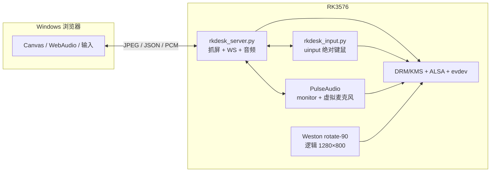

# RKDesk 文档中心

> 面向答辩、面试、接手开发与后续维护。  
> 代码版本：1.1.0（2026-11-04）

## 文档

| 文档 | 适合谁 | 内容 |
| --- | --- | --- |
| [系统说明](ARCHITECTURE.md) | 评委/面试官/新同学 | 目标、总体架构、关键决策、视频/输入/音频链路、部署、性能、限制 |
| [实现步骤与原理](IMPLEMENTATION.md) | 开发者/答辩准备 | 分阶段实现、逐模块拆解、协议/公式、15 个故障复盘、测试度量、答辩速查 |
| [面试问答](INTERVIEW_QA.md) | 面试/答辩 | 40 个技术问答、追问方向、白板题、容易说错的点 |

## 三条阅读路径

### 5 分钟：先建立整体印象

1. 本文“系统一页图”；
2. `ARCHITECTURE.md` 的“一页纸摘要”“总体架构”“关键设计决策”；
3. `INTERVIEW_QA.md` 的“30 秒版本”。

### 30 分钟：准备答辩

1. `ARCHITECTURE.md` 全篇（重点看每章开头的图和表）；
2. `IMPLEMENTATION.md` 的“阶段 0–8”和“15 个真实故障”；
3. `INTERVIEW_QA.md` 的 Q1–Q40，挑 10 个能讲深的。

### 2 小时：能接手开发

1. `IMPLEMENTATION.md` 的“模块逐个拆解”；
2. 对照代码看 `board/rkdesk/*.py`、`c-src/rkdesk_c.c`；
3. 跑一遍“测试与性能度量”；
4. 用 `verify_board.sh` 确认板端/仓库一致。

## 系统一页图



## 关键事实

| 项 | 值 |
| --- | --- |
| 开发板 | TL3576-MiniEVM / RK3576（aarch64） |
| 系统 | Buildroot 2024.02 / Linux 6.1.115-rt16 |
| 合成器 | Weston 14.0.1，DSI 原生 800×1280，逻辑 1280×800 |
| 音频 | PulseAudio 16.1，ES8388 sink/source；无物理扬声器/麦克风 |
| Python 版 | 8088 HTTP / 8443 HTTPS，功能完整 |
| C 版 | 8089 + HTTPS 8444，视频/输入/音频，Pulse 虚拟麦克风 |
| Python 性能 | 15.0 fps / 807 kbps / 52 MB / CPU 64.8% |
| C 性能 | 29.8 fps / 1660 kbps / 7.8 MB / CPU 64.3% |
| C 音频 | `/av` PCM 双工 + `rkdesk_c_mic_source`，HTTPS 8444 |

## 图表索引

### 系统说明

- 五层架构图、部署拓扑图；
- DRM/KMS 组成图、抓帧时序图；
- 旋转链路图；
- 输入链路图、90° 坐标逆变换图；
- PulseAudio 图模型、上下行时序图、虚拟麦克风状态机；
- HTTPS secure context 判定图；
- 启动顺序图、部署流程图；
- C 线程模型图、C 抓帧流程图。

### 实现步骤

- 五层模型、排查闭环；
- 路线决策树；
- DRM 抓帧时序；
- 帧服务/WS 结构；
- 绝对鼠标设备分类图；
- 输入守护时序；
- 三旋转方案对比图；
- 音频状态机；
- C 工具链/抓帧/旋转优化图；
- 测试矩阵与答辩白板顺序。

> 所有图都是 Mermaid，GitHub、VS Code（装 Markdown Preview Mermaid 插件）、Typora
> 等可直接渲染；离线环境可把 ` ```mermaid ` 代码块粘到 mermaid.live 查看。

## 代码与文档的对应

| 主题 | 代码 | 文档 |
| --- | --- | --- |
| 抓屏 | `board/rkdesk/drm.py`、`mirror.py` | ARCHITECTURE 视频链路；IMPLEMENTATION 阶段 2 |
| WebSocket/HTTP | `board/rkdesk/server.py` | 阶段 3；协议章节 |
| 输入 | `board/rkdesk/input.py`、`rkdesk_input.py` | 阶段 4；问题 4/5/6 |
| 旋转/坐标 | `mirror.py`、`web/app.js`、C `PAGE` | 阶段 5；公式章节 |
| 音频 | `board/rkdesk/av.py`、`web/av.js` | 阶段 6；Q20–Q26 |
| HTTPS | `server.py`、`deploy.sh` | 阶段 7；Q23 |
| C 版 | `c-src/rkdesk_c.c`、`build.sh` | 阶段 8；Q27–Q32 |

## 维护约定

- 改协议/坐标/服务顺序时，同步更新 `ARCHITECTURE.md` 和 `IMPLEMENTATION.md`；
- 改板端文件后跑：
  ```bash
  cd RKDesk
  bash tools/verify_board.sh root@192.168.31.153
  ```
- 改性能参数后重新跑 `ws_bench.js`，更新两张表；
- 新增故障复盘时，按“现象 → 定位 → 根因 → 修复 → 原理 → 验证”写，不要只写结论。
